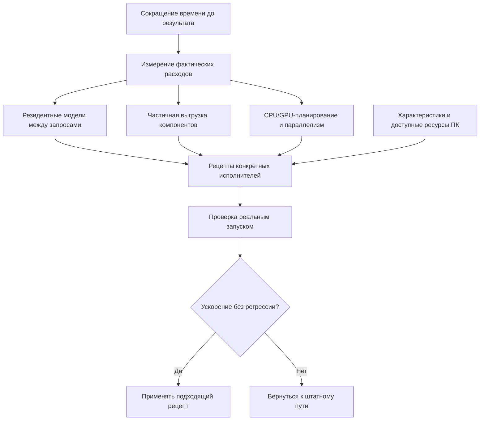

# ЛОПАТА — карта идеи: управление прогретыми моделями и оптимизация вычислительных конвейеров

**Дата:** 11 ноября 2026 года

**Статус:** исследовательская карта идеи, не техническое задание и не решение о реализации.

**Область:** все сценарии ЛОПАТЫ, использующие ИИ; в первую очередь — многоэтапные и многомодельные.

**Основа наблюдений:** опубликованная архитектура репозитория [PiTrolKun/LOPATA](https://github.com/PiTrolKun/LOPATA), обсуждение и первоначальные наблюдения при создании игровых звуков. Локальная DEV-версия может опережать опубликованные исходники.

> **Главная мысль:** модель не должна автоматически выгружаться только потому, что закончился запрос или этап. Подготовленные модели и их компоненты желательно сохранять в работоспособном состоянии, пока это экономит общее время задачи и не мешает более важным вычислениям. Решение принимается по характеристикам реального ПК, исполнителя и текущего сценария.

## 1. Суть и границы универсальности

Идея **универсальна для оборудования и пользовательских сценариев**, а не ориентирована на какую-либо конкретную видеокарту. Условная конфигурация **RTX 4080 / 64 ГБ RAM** использовалась **только как иллюстрация** доступного игрового ПК, а не как целевая платформа, минимальное требование, фиксированный профиль или ограничение алгоритма.

Универсальным может быть **общий механизм**:

- определение возможностей и *текущей* занятости CPU, RAM, GPU, VRAM, диска и подходящих движков;
- измерение стоимости загрузки, инициализации, проверок, вычислений, выгрузки и обратного переноса;
- учёт памяти весов, рабочего контекста/KV, промежуточных тензоров, буферов и других компонентов;
- управление резидентными исполнителями, резервированием ресурсов, освобождением и возвращением моделей;
- накопление результатов измерений и выбор обоснованной стратегии;
- корректное завершение, смена модели, отмена, пауза, восстановление и обработка нехватки памяти.

**Неуниверсальны конкретные рецепты исполнения.** Способ размещения, частичного переноса и параллельной работы зависит от сочетания **сценарий × движок × модель и её ревизия × параметры задачи × оборудование × доступная память**. Рецепты должны строиться и проверяться для соответствующих исполнителей; универсальный диспетчер лишь помогает их применять.

### Карта направлений

## 2. Два основных исследовательских направления

### А. Частичное освобождение VRAM, а не полная перезагрузка

Если следующему этапу не хватает, условно, 1–2 ГБ VRAM, проверить, можно ли **перенести в RAM только необходимую часть весов или неактивный компонент**, выполнить операцию и вернуть его обратно. Возможный выигрыш — отсутствие повторного полного цикла подготовки большой модели.

Важно отличать:

- выгрузку неиспользуемого **компонента** (например, кодировщика или декодера);
- перенос части **слоёв** большой модели;
- освобождение временных буферов/кеша без переноса весов;
- полноценную выгрузку и повторную инициализацию.

Частичный перенос — **гипотеза для физических испытаний**, а не обещанная оптимизация. Если перенесённые слои нужны на каждом шаге инференса, постоянный обмен через PCIe может оказаться медленнее штатного пути. Также движок может не поддерживать адресное освобождение именно нужного объёма памяти.

### Б. Сохранение готовых исполнителей и распределение CPU/GPU

На ПК с достаточным запасом RAM небольшие модели могут **постоянно работать на CPU**, тогда как GPU занят большой моделью. Более крупные модели могут сохранять подготовленные веса в RAM, чтобы не начинать загрузку с NVMe заново.

Здесь различаются три состояния:

1. **Резидентная GPU-модель** — готова к вычислению на ускорителе.
2. **Резидентная CPU-модель** — экземпляр уже инициализирован и готов отвечать на процессоре.
3. **Подготовленные веса/состояние в RAM** — можно быстрее вернуть модель на GPU, но это *не равно* немедленной готовности к инференсу.

Возможны параллельные работы: CPU подготавливает данные следующего независимого шага, пока GPU вычисляет текущий. Если операции зависят от результатов друг друга, параллелизм ограничен.

**Критерий выбора:** не скорость отдельного инференса, а время *всего пользовательского результата*, включая смену моделей, валидацию и подготовку. Медленное вычисление на CPU может быть выгоднее быстрого вычисления на GPU, если иначе пришлось бы дважды переносить большую модель.

## 3. Почему это возникло

При процедурной генерации коротких звуковых ассетов пользователь наблюдал заметный контраст: холодное выполнение занимало **примерно 30–60 секунд**, а работа с уже подготовленной моделью — **примерно 3–10 секунд**. Числа относятся к пользовательскому наблюдению и не являются универсальным бенчмарком.

Причина потенциальных потерь — не только чтение весов: запуск процесса, инициализация библиотек и движка, размещение памяти, создание контекста, проверки готовности, прогрев, выгрузка и очистка также имеют цену. Частые повторения этого цикла могут преобладать над полезными вычислениями в коротких задачах.

**Важное уточнение:** аудит целостности файлов, проводимый при подготовке, нельзя просто удалять ради скорости. Следует исследовать безопасное переиспользование уже полученного результата при неизменности компонента, не отменяя проверок входов нового задания.

## 4. Карта сценариев ЛОПАТЫ

Оценки ниже являются **гипотезами по опубликованным исходникам**, а не физическим подтверждением работы всех сочетаний моделей на произвольном ПК. «Все модели» означает все необходимые **одновременно подготовленные исполнители текущего сценария**; альтернативные модели каталога не обязаны быть загружены разом.

| Сценарий | Состав и подтверждённое наблюдение по коду | Что исследовать | Предварительная перспектива |
|---|---|---|---|
| **«Живая аркада»** | Qwen2.5-Coder 7B (логика) и 3B (оформление). Переключение двух моделей через один runtime; основные GGUF вместе ~6,79 ГБ на диске, без контекстов | Два отдельных прогретых исполнителя, при достаточной памяти — одновременно GPU, иначе CPU/GPU | **Приоритетный простой полигон** |
| **«Умное» преобразование книг** | Отдельные OCR, визуальная Alpha/Beta, Qwen3 8B, иногда модель разметки; `BookSmartModels.SwitchAsync` освобождает предыдущий исполнитель. Этапы уже сгруппированы по всему документу | Постоянная готовность трёх исполнителей; OCR/структура на CPU, визуальная модель на GPU; сравнить с текущей группировкой | **Высокий** |
| **Генерация изображений** | Z-Image Turbo или Krea 2 Turbo + свой текстовый кодировщик + VAE; отдельно Qwen для промптов и Beta для референсов. Нативный генератор вызывается отдельным процессом | Резидентный **выбранный** графический движок; сохранение кодировщика/VAE; текстовые помощники в RAM/CPU, LoRA без полной пересборки | **Высокий, потребует переработки исполнителя** |
| **Анализ изображений и оформление текста** | Kimi-VL и Qwen3 8B используются как разные исполнители; подготовка частично предусмотрена параллельно | Сохранять обе модели готовыми, распределив устройства; проверить пики при совместной работе | **Высокий** |
| **Музыкальный чат / мастерская рифмы** | Ряд коротких запросов к текстовым моделям; в `MusicPoetryRuntime` и `MusicRhymeCreativeModel` предусмотрено завершение модели после операции | Удержание выбранного текстового исполнителя между последовательными правками | **Очень высокий для интерактивности** |
| **Музыкальные обложки** | Текстовая LLM делает краткое описание, затем Z-Image создаёт обложку | Совместная готовность LLM на CPU и графического генератора на GPU, если позволяет память | **Высокий** |
| **Генерация песен** | Альтернативные YuE2, ACE-Step, DiffRhythm 2, HeartMuLa имеют собственные многоэтапные наборы и спутниковые модели | Сохранять **выбранный** движок между дублями; индивидуально удерживать/переносить его компоненты; необязательный переключатель в музыкальном сценарии | **Высокий, но очень разный по движкам** |
| **Выравнивание текста, караоке, аудиообработка** | После генерации может запускаться GigaAM CTC, разделение дорожек и другая обработка; встречаются принудительные освобождения моделей | CPU-резидентные вспомогательные модели, чтобы не вытеснять основной музыкальный исполнитель | **Средний–высокий** |
| **Литературный сценарий** | «Советник» и «Писатель» — логические роли **одной** Qwen3.8-27B Ridge, а не две модели. Есть RAG/векторизация/память | Не дублировать 27B; удерживать независимые вспомогательные модели и индексы, если это приносит выигрыш | **Средний–высокий для вспомогательных этапов** |
| **RAG и база знаний** | Giga Embeddings 3B, поиск, отдельные текстовые помощники в смежных операциях | Долговременная CPU-резидентная модель эмбеддингов и повторное использование между индексированием/поиском; совместное размещение с LLM | **Высокий** |
| **AI Office: перевод, пересказ, речь** | Одна выбранная текстовая модель, отдельные TTS/ASR-исполнители; некоторые runtime уже используются повторно внутри задания | Не выгружать LLM между действиями; держать CPU-резидентными TTS/ASR при достаточной памяти | **Высокий для последовательной работы** |
| **«Если накипело»** | Gemma 4 уже резидентна в обычном чате; перед распознаванием аудиовложения происходит освобождение и последующая подготовка модели; зрительный проектор подключается отдельно | Распознавание речи на CPU при сохранении готовой Gemma; проверка работы с изображениями без лишнего перезапуска | **Высокий для вложений** |
| **Подготовка видео** | Текстовая Qwen резидентна; референсы генерируются отдельным графическим движком | Не выгружать помощника при независимой работе с референсами, если хватает RAM; не удерживать лишнее перед тяжёлым H3 | **Средний–высокий** |
| **«Песня → клип»** | Отдельные планирование на LLM, анализ, генерация H3 / InfiniteTalk / другие исполнители. Планировщик может жить в течение нескольких пакетов, затем освобождается | Сопоставить последовательность, стоимость возврата моделей и свободную RAM; раздельные рецепты по видеодвижкам | [Восстановление и замеры в 0.8.10-dev](#применение-в-сценарии-клипов) |
| **Апскейл видео** | Цепочка обрабатывает фрагменты; нейросетевые шаги запускаются отдельными процессами | Один резидентный исполнитель для повторяющихся фрагментов, без постоянной перезагрузки модели на каждом шаге | **Очень высокий при повторных фрагментах** |
| **MiniMax H3 / Wan VACE** | В одном задании уже повторно используются основные объекты для последовательных коротких фрагментов; между фазами часть памяти намеренно освобождается | Адресная выгрузка, RAM-резерв, перекрытие независимых CPU/GPU-операций; исследовать существующие ограничения | **Сложный исследовательский случай** |

### Смежные сценарии с одной LLM

**Vibe Coding 1С, финансовый сценарий, часть SVG- и текстовых утилит**: обычно используют **одну модель**, а остальные этапы выполняются программными средствами. Для них важна резидентность и сокращение стоимости повторных запросов, но искусственно вводить многомодельную схему не требуется.

**Новый сценарий игровых звуков:** синтез аудио выполняется на CPU независимо от LLM. При переключении одной из выбранных моделей предполагается остановка текущей попытки и повтор того же запроса после прогрева новой. Текущий документ об игровых звуках — рабочее ТЗ/DEV-реализация, а не подтверждение опубликованного релиза. Резидентность выбранной LLM особенно выгодна при серии коротких исправлений звука.

## 5. Что уже частично реализовано

- **Резидентные текстовые модели:** отдельные механизмы есть в видеоподготовке, «Если накипело» и других службах. Не начинать с предположения, что вся ЛОПАТА всегда выгружает модели после запроса.
- **Группировка одинаковых этапов:** умная конвертация книг обрабатывает визуальные проверки до OCR, чтобы уменьшать число переключений.
- **Внутризадачное повторное использование:** H3/VACE обрабатывают последовательные фрагменты одним процессом; не запускают весь движок с нуля на каждый фрагмент.
- **Контрольные точки:** сценарии сохраняют подтверждённые результаты и умеют продолжать работу; новые способы удержания не должны нарушить восстановление и отсутствие дублей.
- **Аппаратная проверка:** в проекте уже существуют выбор размещения, контроль памяти и аудит моделей; их целесообразно использовать, а не заменять отдельной параллельной подсистемой без необходимости.

### Применение в «Простой генерации»

20.11.2026, `0.8.71-dev`. После входа в рабочее окно выбранный совместимый `sd-server` проходит короткий служебный запрос. Это задействует компоненты, которые движок загружает при первом запросе. Круговой индикатор показывает, что модель ещё готовится. Служебный кадр не попадает в историю. Процесс сохраняется между запросами. Смена модели, выход из сценария и освобождение ресурсов другими операциями используют общий реестр процессов. Старый движок без совместимого сервера и запросы с LoRA используют штатный разовый запуск.

Пользователь подтвердил, что видит круг на MiniMax. В `0.8.72-dev` перед первым шагом потребовалось 726,05 МиБ, Vulkan сообщил 323,09 МиБ доступной памяти. В `0.8.73-dev` задан резерв 4 ГиБ при запуске MiniMax на GPU. Контрольный прогрев 1024×1024 с весами на `E:` завершился за 592 с, движок остался загруженным, пользователь подтвердил готовность. Прошли 82 автоматические проверки, две проверки с явно заданными моделями пропущены. Тот же процесс выполнил три одиночных запроса и первый кадр следующего пакета. Два запроса 1024×1024 заняли 31,80 и 21,98 с. Освобождение процесса при выходе остаётся в программе испытаний. [Дополнение к ТЗ MiniMax](../../ТЗ/Архив/2026-11-20_MiniMax_H3_Image_в_Простой_генерации.md#дополнение-от-20-ноября-2026-года-прогрев-выбранной-модели)

20.11.2026, `0.8.75-dev`. На наборе 002 подтверждены предварительный прогрев и освобождение по «Назад» для Z-Image Turbo, Krea 2 Turbo, Qwen-Image-2.1 Turbo INT8 и Qwen-Image-2.1 Base GGUF. Настройки сервера Qwen одинаковы при смене размера. Индикатор виден у каждой модели, служебные кадры в историю не записаны. [Результаты испытаний](../../ТЗ/Архив/2026-11-20_MiniMax_H3_Image_в_Простой_генерации.md#прогрев-остальных-моделей-простой-генерации)

### Применение в сценарии клипов

Запись от 16.11.2026 по доработке «Песня → клип» в 0.8.10-dev.

- **Реализовано. Перенос весов в RAM при сбое GPU (§ 2А и § 8).** При нехватке видеопамяти и отдельных сбоях CUDA ЛОПАТА один раз перезапускает обработчик с переносом весов в оперативную память. Автоповтор проверен с имитацией ошибок, а запуск с переносом весов испытан на связном H3, Geekatplay и Glitchframe.
- **Реализовано. Продолжение с контрольной точки (§ 5 и § 8).** При повторе используются принятые сцены плана и готовые материалы. После перезагрузок связный H3 и Geekatplay дорендерили только недостающие фрагменты. Glitchframe переиспользовал готовый опорный кадр.
- **Эксперимент. Параллельная подготовка (§ 2Б).** Запуск планировщика Qwen одновременно с анализом ритма Any Song сократил подготовку плана примерно на 7 секунд на контрольном отрывке.
- **Эксперимент. Переиспользование подготовленных компонентов (§ 2Б).** Удержание текстового кодировщика H3 в RAM между сценами сэкономило 2–3 секунды на коротком рендере. Итоговые MP4 совпали побайтно.

Сквозное сравнение времени от «Старт» до готового MP4 на одном проекте с одинаковыми настройками (§ 7) остаётся открытым. [ТЗ «Песня → клип»](../../ТЗ/Архив/2026-11-13_Песня_в_клип_адаптивные_лимиты.md) · [Протокол испытаний](../../Документы_проекта/Песня_в_клип_Проверки_2026-11-15.md)

## 6. Универсальные параметры для выбора рецепта

**Измерять текущие, а не только паспортные характеристики:**

- CPU: число доступных потоков, эффективность конкретного инференса, фактическая нагрузка;
- RAM: физический объём, свободный остаток, доступный commit, резерв ОС и приложения;
- GPU: поддерживаемый backend, общий и *свободный* объём VRAM, текущая занятость и рабочие пики;
- пропускную способность и накладные расходы RAM ↔ VRAM и NVMe → RAM, **по измерениям**, а не по названию шины;
- модель: размер всех весов, квантовка, совместимость, устройство, KV/контекст, дополнительные проекторы/LoRA/VAE/кодировщики;
- исполнитель: поддержка постоянного процесса, горячей замены, частичной выгрузки, очистки кеша и повторных запросов;
- сценарий: повторяемость запросов, зависимости этапов, требуемые промежуточные данные, длительность задачи.

Нужны разные профили для мощного игрового ПК, среднего ПК, ограниченного RAM, CPU-only и конфигураций с несколькими GPU. **Это не жёсткие категории по модели видеокарты, а выбираемые по измеренным возможностям стратегии.** Если нет подтверждённого ускорения или ресурсов — применять штатный путь.

## 7. Что и как испытывать

**Базовый контроль:** действующая реализация без изменений. Для каждого кандидата сравнить:

1. Холодный первый запрос; повторный запрос к той же модели; переключение A → B → A; несколько последовательных результатов.
2. Удержание выбранной модели на GPU; удержание на CPU; подготовленные веса в RAM; частичную выгрузку; независимые CPU/GPU-шаги параллельно.
3. Время *полной задачи*, а не только время вычислительного ядра; отдельно — ожидание пользователя до первого полезного результата.
4. Пиковую RAM, VRAM и commit; количество повторных загрузок весов, запусков процесса, проверок и перемещений памяти.
5. Стабильность и идентичность/сопоставимость результата при неизменных seed, настройках и версиях, где детерминизм применим.
6. Отмену, STOP, смену модели, паузу, восстановление, аварии процесса, недостаток памяти и возвращение ресурса без утечки.
7. Несколько конфигураций оборудования. RTX 4080 / 64 ГБ — **один возможный стенд**, а не основа правил.

Отдельно фиксировать, **что именно означает «прогретая» модель**: только файл отображён в память, создан процесс/сервер, модель на CPU, модель на GPU, готова первая инференс-команда или уже подготовлен контекст. Называть все эти состояния одним словом без замеров нельзя.

### Первые полигоны

**«Живая аркада»** — проще всего проверить эффект от постоянного удержания *двух разных* моделей: две известные GGUF, частые переключения, небольшой объём весов по меркам игрового ПК.

**«Умные книги»** — показывает эффект от устранения смены трёх подготовленных исполнителей; важно сравнить с уже реализованным группированием этапов.

**Музыкальный чат/мастерская рифмы и игровые звуки** — короткие повторные запросы лучше всего демонстрируют выигрыш пользовательского времени.

**Апскейл видео и генерация изображений** — отдельное исследование длительно живущего исполнителя вместо повторных процессов.

**H3, VACE, InfiniteTalk, ACE-Step и HeartMuLa** — после лёгких примеров, по индивидуальным рецептам и физическим профилям памяти.

## 8. Условия корректности

- Не удалять обязательные проверки файлов и лицензий; исследовать правильное кэширование результатов для неизменного содержимого.
- Нельзя незаметно менять выбранную модель, квантовку, точность, качество, контекст, рецепт или seed ради экономии памяти.
- Не считать размер файла фактическим потреблением RAM или VRAM; вместе с моделью работают контексты, буферы, кеши и библиотеки.
- Не обещать ускорение до физического теста; возможны замедление из-за CPU, PCIe, конкуренции за RAM или повторной материализации весов.
- Подтверждённые результаты, контрольные точки, источник модели и журнал операций остаются воспроизводимыми.
- Не держать невостребованное в VRAM ценой блокировки основного этапа; предпочтительна **адаптивная резидентность**, а не принудительное удержание всех моделей любой ценой.
- После ошибки или исчерпания ресурсов — явное восстановление и проверенный запасной способ исполнения.

## 9. Итоговая формулировка идеи

**Универсальная система ЛОПАТЫ должна уметь измерять стоимость жизни моделей и управлять их готовностью на произвольном поддерживаемом ПК.** Для каждого сценария и исполнителя выбирается проверенный рецепт: что оставить прогретым, что перенести в RAM, что считать на CPU, что держать на GPU, какие этапы перекрывать и когда действительно выгодно освобождать память.

**Цель — не минимальное потребление памяти и не максимальные токены в секунду, а минимальное время получения полноценного результата без ухудшения качества, надёжности и управляемости.**

---

## Источники наблюдений: опубликованный репозиторий

- [Общая навигация и сценарии](https://github.com/PiTrolKun/LOPATA/blob/main/Исходники/AIHub/Services/ScenarioNavigationCatalog.cs)
- [Живая аркада: модели](https://github.com/PiTrolKun/LOPATA/blob/main/Исходники/AIHub/Services/LivingArcade/LivingArcadeModels.cs) · [смена модели](https://github.com/PiTrolKun/LOPATA/blob/main/Исходники/AIHub/Services/LivingArcade/LivingArcadeGeneration.Calls.cs)
- [Умные книги: смена этапов](https://github.com/PiTrolKun/LOPATA/blob/main/Исходники/AIHub/Services/Books/Smart/BookSmartModels.cs) · [обработка](https://github.com/PiTrolKun/LOPATA/blob/main/Исходники/AIHub/Services/Books/Smart/BookSmartProcessor.cs)
- [Генерация изображений: исполнитель](https://github.com/PiTrolKun/LOPATA/blob/main/Исходники/AIHub/Services/ImageGenerationRuntime.cs) · [комплекты весов](https://github.com/PiTrolKun/LOPATA/blob/main/Исходники/AIHub/Tools/image-generation-manifest.json)
- [Музыкальный чат: жизненный цикл](https://github.com/PiTrolKun/LOPATA/blob/main/Исходники/AIHub/Services/MusicPoetryRuntime.cs) · [генерация обложек](https://github.com/PiTrolKun/LOPATA/blob/main/Исходники/AIHub/Services/MusicCoverWork.cs)
- [Литературный исполнитель](https://github.com/PiTrolKun/LOPATA/blob/main/Исходники/AIHub/Services/LiteraryChatRuntime.cs) · [обработка изображений + текст](https://github.com/PiTrolKun/LOPATA/blob/main/Исходники/AIHub/Services/ImageAnalysisLiteraryService.cs)
- [«Если накипело»: жизненный цикл](https://github.com/PiTrolKun/LOPATA/blob/main/Исходники/AIHub/Services/LetItOutChatRuntime.cs)
- [Подготовка видео: резидентная модель](https://github.com/PiTrolKun/LOPATA/blob/main/Исходники/AIHub/Services/VideoPreparation/VideoConceptAssistant.Resident.cs)
- [Апскейл видео: цепочка](https://github.com/PiTrolKun/LOPATA/blob/main/Исходники/AIHub/Services/VideoUpscale/UpscalePipeline.cs) · [исполнитель](https://github.com/PiTrolKun/LOPATA/blob/main/Исходники/AIHub/Services/VideoUpscale/UpscaleNative.cs)
- [Физические измерения H3](https://github.com/PiTrolKun/LOPATA/blob/main/Тесты/VideoH3Memory_20261030/README.md)
- [Планировщик «Песня → клип»](https://github.com/PiTrolKun/LOPATA/blob/main/Исходники/AIHub/Services/SongClip/SongClipPlannerModel.cs)

20.11.2026 пользователь принял прогрев всех пяти моделей «Простой генерации» на наборе 002. Остальные пункты карты ведутся отдельно. [ТЗ в архиве](../../ТЗ/Архив/2026-11-20_MiniMax_H3_Image_в_Простой_генерации.md)
