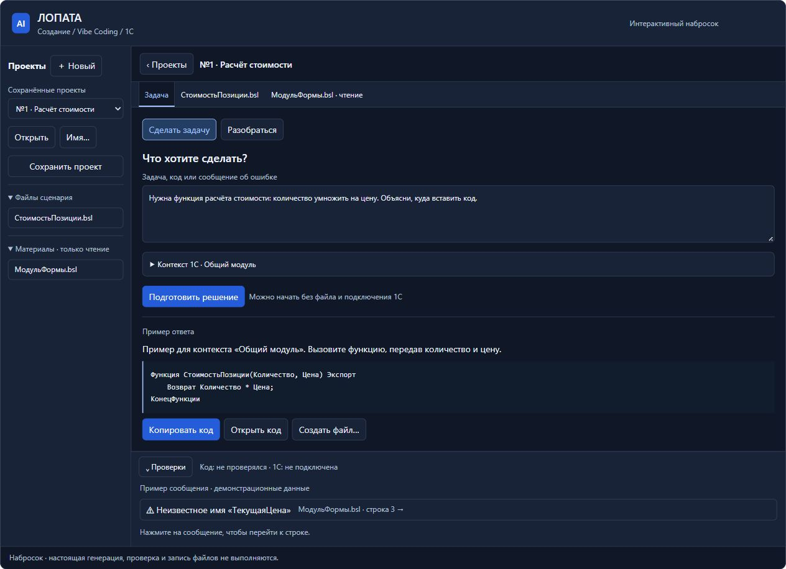
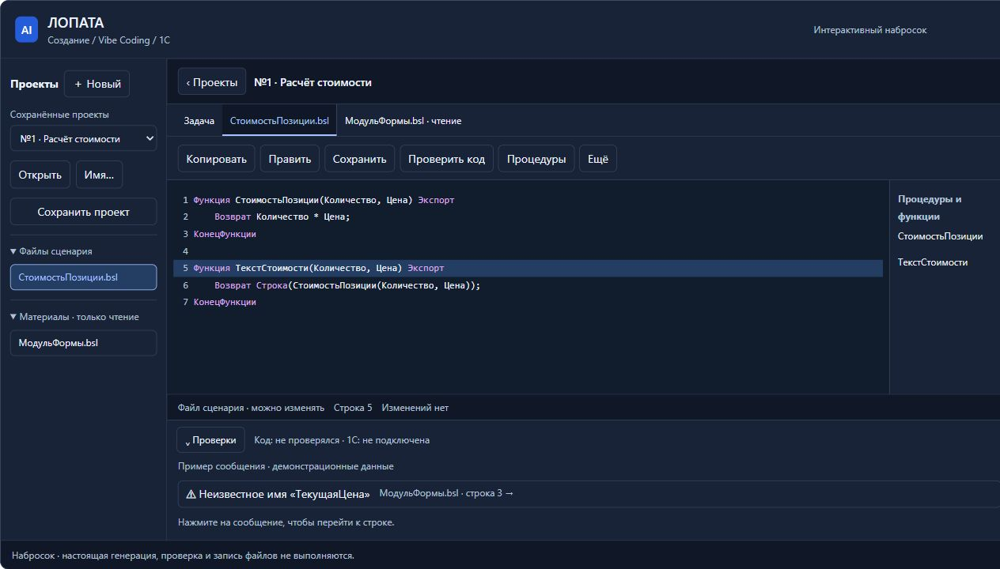
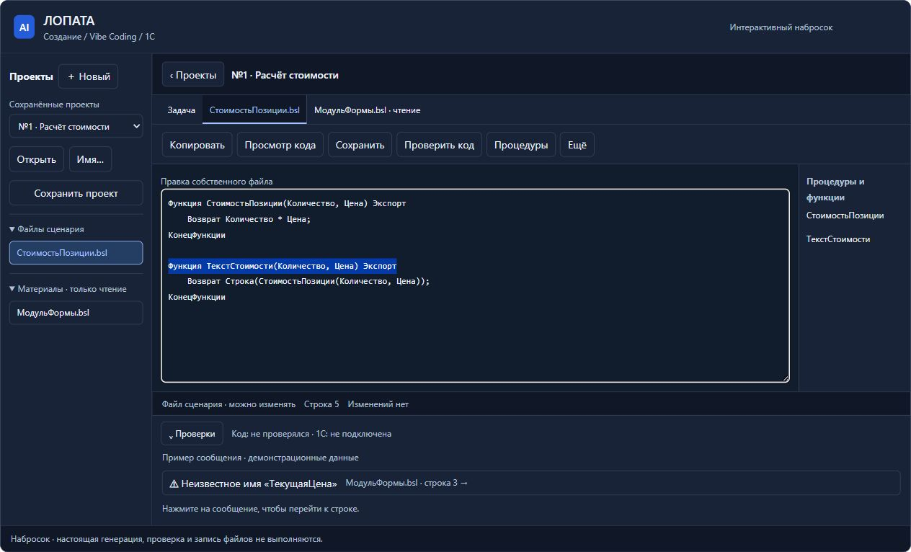
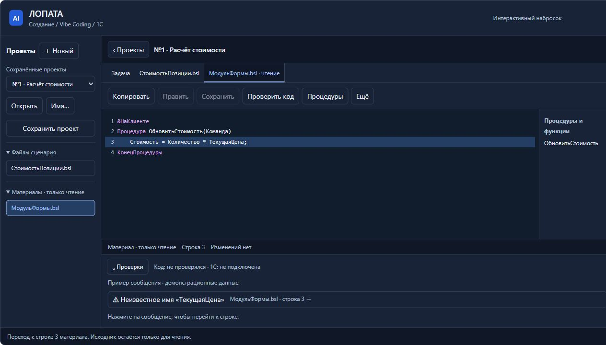
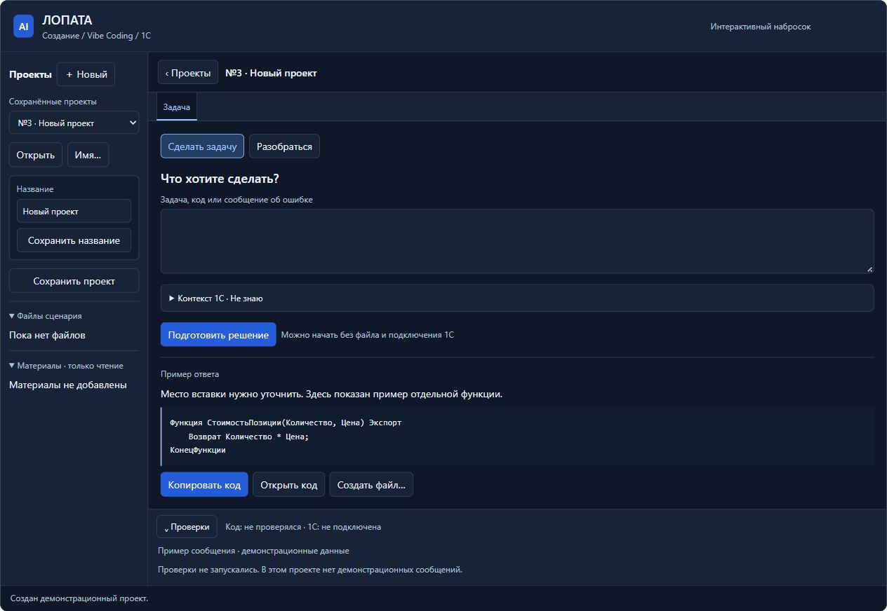
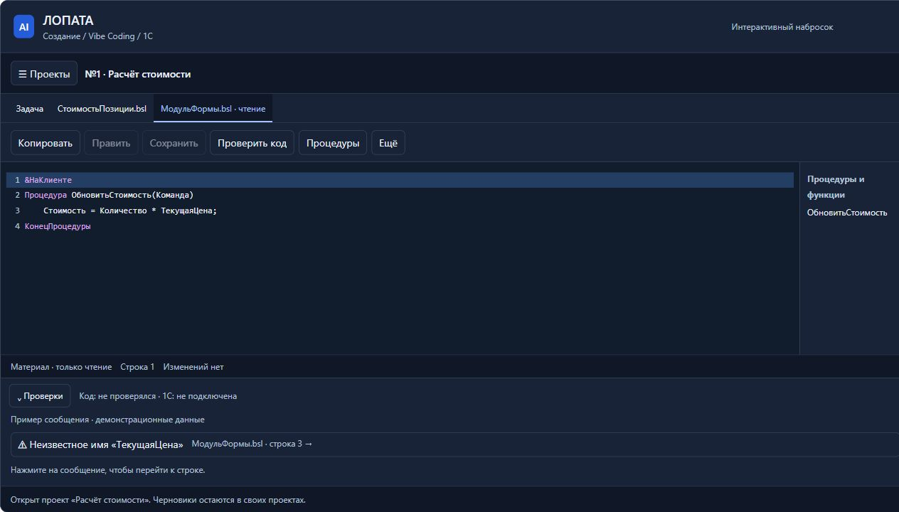

# Самопроверка наброска сценария 1С

Дата: 10.11.2026. Статус: анализ интерфейса, предложения для обсуждения. [ТЗ](../../ТЗ/2026-11-10_1С_Программирование_и_обучение.md), [исследование интерфейсов программирования](2026-11-10_Исследование_интерфейсов.md).

Проверен новый набросок one-c-coding через фоновый in-app Browser. Исходный набросок не изменён. Все шесть снимков получены и просмотрены в этом проходе; прежние снимки не использованы как доказательства. Временная HTML-обёртка задавала UTF-8 для самостоятельного открытия фрагмента; ошибка кодировки первого открытия относилась к этой обёртке, была исправлена до принятых снимков и не отнесена к продукту.

## Вывод

Компоновка узнаваема для работы с кодом: файлы слева, вкладки в центре, процедуры рядом и замечания снизу. Для первого цикла избыточного набора инструментов нет. Основная недоработка — связь исходного материала, задачи, предложенного изменения и файла результата. Для процесса через копирование она важнее дополнительных возможностей IDE.

До реализации рекомендуется уточнить три вещи: единый редактор без смены вида при правке, явное добавление/использование исходного кода и понятную связь результата с файлом. Остальные замечания можно решать следующим слоем.

## Проверенные шаги

### 1. Задача и результат — нужны уточнения

Основное действие и копирование заметны; первый вопрос помещается в одну простую форму. Но для основного пути «у меня уже есть код/ошибка» нет явного добавления материала или использования вставленного исходника. Одно поле смешивает описание задачи, код и сообщение об ошибке.

Предложение: видимое действие «Добавить исходный код или файл». Исходник становится материалом для чтения; рядом можно задать, что с ним требуется сделать. Термины контекста снабдить короткими пояснениями. В новом проекте уже есть безопасное значение «Не знаю» — его следует сохранить.

### 2. Открытие кода и переход по процедурам — основа удачная

Переход к «ТекстСтоимости» выделил строку 5. Вкладка, список файлов и процедуры работают как связанное рабочее место. Однако ответ показывает одну функцию, а «Открыть код» открывает модуль с двумя. Для демонстрации это допустимые примеры, но связь «этот ответ → этот файл/фрагмент» в интерфейсе не обозначена.

Предложение: ответ имеет явные имя/назначение и действия «Копировать результат», «Создать файл» или «Предложить изменение собственного файла». Для правки исходника — отдельные «Исходный код / Предложение» и пояснение места замены. Право менять материал не появляется.

### 3. Ручная правка — нужно переделать

Нажатие «Править» заменило подсвеченный код с номерами строк обычным текстовым полем. Границы и высота редактора тоже изменились. Это лишний режим для собственной редактируемой работы и потеря полезной навигации именно во время ввода.

Предложение: один редактор с подсветкой, строками и одинаковой геометрией. Собственные файлы редактируются непосредственно; материал использует тот же вид с режимом чтения. Сохранить различимые состояние прав и признак несохранённых изменений.

### 4. Замечание и исходник — переход и ограничение прав удачны

Сообщение открыло «МодульФормы.bsl» и выделило строку 3. Метки чтения видны; «Править» и «Сохранить» отключены. Но следующий полезный шаг для помощника спрятан: нет явной команды «Использовать в задаче» / «Предложить исправление» с отдельным результатом.

Предложение: добавить такое действие для материала, выделения или выбранного замечания. В панели проверок указать область действия («проект»/«текущий файл»), источник диагностики и актуальность относительно кода. Сообщение другого файла допустимо в проверках проекта, но должно быть понятно, почему оно здесь. Эти предложения не превращают статическую проверку в запуск 1С.

### 5. Проекты и возврат — базовые действия есть, восстановление неполное

Новый проект появился с пустой задачей и контекстом «Не знаю». При возврате в первый проект восстановился активный материал. Панель проектов свернулась, освобождая ширину; кнопка возврата и имя проекта остались видимыми.

В то же время после переключения проектов выбранная строка сбросилась с 3 на 1. Это наблюдаемое ограничение наброска: при реализации надо восстанавливать курсор/выделение и положение каждого файла. Короткое «Имя…» стоит заменить ясным «Переименовать».

«Сохранить название», «Сохранить проект» и «Сохранить» файла требуют понятной границы. Предложение: явно обозначить состояние проекта и файла, описать, что записывает каждая команда, и проверить поведение с несколькими несохранёнными файлами. Готовый пример ответа в пустом проекте — заглушка наброска; его не считаем ошибкой реальной генерации.

## Второй приоритет

- У открытых файлов понадобится понятное закрытие вкладки; сейчас виден только переход между ними. Поведение с большим числом файлов этим проходом не проверено.
- При двух коротких функциях отдельная панель процедур занимает много места. Её можно оставить опциональной; сворачивание уже предусмотрено.
- Код и вспомогательные подписи небольшие. Нужны настройка шрифта и проверка масштабов, предусмотренная ТЗ; соответствие требованиям доступности по этим снимкам не заявляется.
- После перехода к коду accessibility-состояние показывало фокус на документе, а не на новом редакторе/вкладке. Управление фокусом и полный клавиатурный маршрут требуют отдельной проверки.

## Ограничения проверки

Оценены видимые действия и переходы, перечисленные в пяти шагах. Копирование как следующий шаг видно в интерфейсе, но содержимое буфера в этом проходе не проверялось. Генерация модели, фактический анализ BSL, запись проектов, восстановление после сбоя и реальная платформа отсутствуют в наброске и не оценивались как работающие возможности. Демонстрационные ответы и ошибки не выдаются за результаты анализа.

Проверена широкая тёмная компоновка в браузере по умолчанию. Новых проверок узкого окна, светлой темы, всех масштабов, экранного диктора, клавиатурного маршрута и полного контраста в этом проходе нет; старые проверки наброска не подменяют их. Метки чтения и фокус наблюдались дополнительно через accessibility-состояние браузера. Это не пользовательское тестирование с представителями целевой аудитории.

## Рекомендуемая последовательность доработки

1. Связать путь: исходный код → задача → отдельное предложение → сравнение/место замены → копирование или собственный файл.
2. Сделать единый редактор для просмотра и правки, с режимом чтения по принадлежности.
3. Уточнить сохранение, область проверок и восстановление позиции.
4. Затем доработать подписи, вкладки, шрифт и клавиатуру.

Самопроверка не является командой на реализацию или приёмкой сценария. Набросок и продукт в этом проходе не правились; сохранены отчёт, снимки и замечания к рабочему ТЗ.
