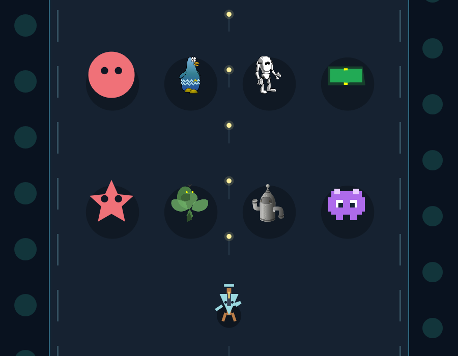

# «Живая аркада»: объединённая база графики и механик

Дата: 06.11.2026. Версия: 0.7.27-dev. Статус: локальное внедрение в действующий
сценарий, без публикации. ТЗ: `ТЗ/2026-11-06_Живая_аркада.md`, раздел15.7.

## Решение

Библиотека дополняет текущую генерацию, а не заменяет её. Доступны одновременно
прежние процедурные формы, свободные готовые персонажи/позы/части, собственные
составные векторные и пиксельные рисунки моделей. Из часового исследования
перенесены исполнимые примитивы и два проверенных оригинальных рисунка; ошибочные
или франшизные имитации остаются только в протоколах исследования.

## Состав библиотеки

329 записей,345 подготовленных PNG256RGBA,7 авторских/собранных циклов.
Полная поставка714 файлов,20 583 401 байт (19,63 MiB), без нового runtime.

| Набор | Записей | Источник |
|---|---:|---|
| Glitch |102| Tiny Speck/bart, OGA и официальный репозиторий |
| Jamie 8-Bit Dungeon |61| Jamie Cross, itch.io |
| Kenney Shape Characters |124|104 части и20 готовых сборок |
| Blue Bird |20| mirex, OGA |
| Cartoon Jester |1| laetissima, OGA |
| Cartoon Vector Characters |19| laetissima, OGA |
| Исследование ЛОПАТЫ |2| оригинальные танк и дракон Gemma |

Роли:166 персонажей,34 предмета,19 тайлов,110 частей. Шесть полностью скрытых
авторских SVG сохранены как source-only, без игровых кадров. Они не выбираются
противниками или слоями. Для Centaur только во временной копии рендера удалён
невидимый редакторский слой со ссылкой на локальный файл автора; оригинал сохранён.

Оригиналы, авторы, тексты CC0, source-page и хеши находятся рядом с каталогом.
Исследовательские иллюстрации не объявляются CC0; фактическая Gemma revision
`7b92b5b28818151e8669af2e45e88d6086f490dd` сохранена в каталоге/PNG.
Новые модели для этого внедрения не скачивались; игровая пара3B/7B сохранена.

## Модель и отрисовка

Художник получает название/механику противника, меняющуюся подборку персонажей
и частей, реальные основные цвета. Все элементы библиотеки достижимы между
уровнями; в контекст не помещаются сотни полных SVG. Самостоятельный рисунок
остаётся допустимым вариантом. Палитра, дополнительные слои/детали и простое
движение дополняют исходник; bob/sway не называются полноценной ходьбой.

Данные ограничены: canvas256,до8 кадров/128 контуров на кадр/512 суммарно,
палитра8 замен,16 геометрических деталей и8 библиотечных слоёв. Профиль генерации
компактнее общего формата: до3 кадров и32 фигур на кадр. Координаты конечны,
повороты/размеры ограничены; XML, код, внешние URL и файловые пути не исполняются.
Рендер использует кешированные PNG и геометрию, подготовленные до начала игры.

Старые прохождения не переоформляются автоматически. Новые первые уровни
сохраняют авторскую механику и получают библиотечную одежду. Источники каждого
использованного ассета и ревизия каталога сохраняются в AssetCredits уровня.

## Исполнитель механик

- Предупреждение→рывок→восстановление с таймерными фазами.
- Полный щит или вращающаяся открытая дуга с реальным пропуском урона.
- Возвращающиеся снаряды: к стрелку, а после его смерти — к исходной точке;
  снаряд исчезает, существует не дольше12 секунд.
- Сочетания с прежним разделением после смерти, волнами и бонусами.

Постоянно неуязвимый цикл, необъявленный рывок, чрезмерный бюджет снарядов и
массовые крупные встречи отклоняются. Рисунок не меняет коллизионный радиус.
С третьего уровня8% детерминированно выбранных уровней разрешают одну крупную
встречу радиуса до0,20; модель может её не выбрать. Это начальная калибровка,
не установленный предел возможностей. Длительное игровое балансирование отдельно.

## Проверка и ограничения

Подключены общий ComponentAudit и существующие фоновые операции. Источник доверия —
embedded manifest/catalog; ревизия аудита включает SHA манифеста, поэтому обновление
ресурсов требует полного прохода. Наличие/хеши всех714 файлов проверены независимо.
Лицензии моделей и пользовательские согласия не подменялись.

Проверки игрового исполнения, смешанной WPF-сцены, старых форм/сохранений,
ролей каталога, полного аудита и удаления обязательного файла проходят.
Финальный набор: 113 успешных, 0 ошибок, 3 opt-in проверки пропущены; нативный
цикл запущен и пройден отдельно. Кириллица/UTF-8 (43 файла кода и5 документов)
и diff проверены. Safe-start выполнил restore/build без предупреждений/ошибок
и открыл главное окно «ЛОПАТА0.7.27-dev». Игровое прохождение пользователю не запускалось.
Модельный прогон выполняется отдельно и сохраняет запросы/ответы, ошибки и метрики
в `_tmp/arcade-library-native-20261106*`; это не пользовательские прохождения.

Первый реальный прогон нашёл три неисполняемых порядка фаз: модель ставила dash
перед hold. Ошибки честно отклонены, runtime завершён. Схема дизайнера изменена:
связанные ограничения фаз, длительностей и возврата снарядов теперь задаются
в JSON grammar. Пустые speed-enum исключены общей проверкой допустимых скоростей;
вход в видимую область считается последовательно по фазам, а не средней скоростью.

Следующий полный прогон v2 прошёл за65,18с и исполнил orbit→hold→dash с
возвращающимися снарядами. Однако художник выбрал только прежние формы, поэтому
этот проход не считался подтверждением выбора новой графики. Теперь художник
должен оформить хотя бы ведущего противника библиотечным или собственным рисунком;
остальные могут сохранять прежнюю процедурную форму.

После сбоя ПК повторный прогон v3 выявил превышение бюджета снарядов во всех
трёх кандидатах программиста. Предел480 не повышался. Схема теперь выделяет
стреляющему ведущему роль согласно его темпу огня; сопровождение не стреляет,
а число его волн/разделений ограничено. Самые тяжёлые предложенные сочетания
проверяются настоящим расчётом стоимости. Всего предлагается12 волн; модель
выбирает их время, размещение, движения, параметры и разрешённые мини-события.
Для чередующегося щита схема и проверка требуют реальную защищённую фазу:
цикл, в котором все щиты случайно получались выключенными, исключён.

Прогон v4 прошёл полностью:79,93с по метрикам сценария,82,53с вместе с тестовой
обвязкой. Все6 реальных вызовов выполнены без повторов: мини-события, дизайн,
программирование, критика, рисунок, будущий замысел. Фактический backend — Vulkan,
RTX4090, контекст16384. Это измерение одного ПК, а не обещанная скорость на других.
Получен цикл hold→dash по3с, без стрельбы. Проверка стоимости:13 противников
в пике, три симуляционные траектории; две дошли до конца, одна погибла.
Художник выбрал `jamie-player-idle`, добавил библиотечный слой и оставил
сопровождение прежним кругом. Источник Jamie Cross/CC0 записан в AssetCredits.
Успех формата не означает, что лишний маленький слой художественно удачен.
Свой модельный runtime завершён (`modelExecutionRetired=true`), работающие
пользовательские прохождения этим прогоном не изменялись.

Первичные запросы, ответы, неудачные кандидаты, принятый уровень, probe и метрики
v1–v4 сохранены в указанных каталогах. Сбой ПК не повредил исходники и предыдущие
TRX; последний до сбоя набор111 проверок завершился успешно.

На проверочной WPF-сцене одновременно видны старые формы, реальные библиотечные
персонажи, исследовательский дракон и составные рисунки тестового кода.
Тестовые составные рисунки не приписываются модели; реальный выбор художника
подтверждается отдельно ответом v4.

Наличие корректной картинки/JSON не гарантирует художественное качество или
баланс. Другие ПК, долговременный FPS и сотни реальных прохождений не испытаны.
Полные исследовательские материалы и неудачные ответы сохранены.
