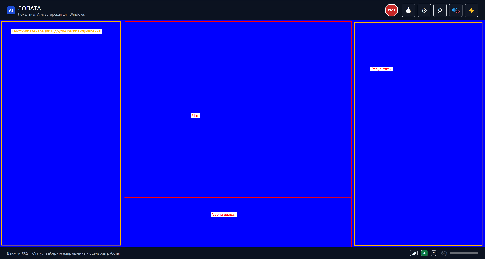

# Процедурное создание игровых звуков в ЛОПАТЕ

Дата — 11.11.2026. Статус — выполнено и принято пользователем 11.11.2026. Решение опубликовано в [0.7.83-beta](https://github.com/PiTrolKun/LOPATA/releases/tag/v0.7.83-beta).

[Исходная концепция](Концепция_процедурного_создания_игровых_звуков_LOPATA.md)

## 1. Задача

Добавить самостоятельный сценарий для создания коротких звуковых эффектов для игр, модов и интерфейсов. Пользователь может описать эффект обычными словами или сразу настроить его вручную. На экране всегда один текущий звук. Локальная языковая модель предлагает значения настроек, а процедурный синтезатор рассчитывает звуковую волну. Настройки доступны для ручной правки, повторного открытия и воспроизведения звука.

## 2. Первый рабочий этап

- Точка входа — «Создание → Аудио → Игровые звуки». Группа «Музыка» в «Создании» переименовывается в «Аудио» / Audio. Карточка «Игровые звуки» размещается сразу после «Музыкального сценария» в этой группе. Рабочее окно ЛОПАТЫ содержит поле описания, настройки текущего звука, прослушивание, сохранение рецепта и экспорт WAV. Интерфейс следует существующим темам и поддерживает RU/EN. [Набросок расположения](../Материалы/Игровые_звуки/2026-11-11_Группа_Аудио.png)
- Для начала работы доступны рецепты «Монетка», «Прыжок», «Лазер», «Попадание», «Взрыв» и «Щелчок меню». Рецепт заполняет настройки того же звука. Каждый пример собирается из параметров синтеза.
- В режиме «Генерация» отправка описания создаёт рецепт звука. При включённой оркестрации эффект собирается по одному слою за запрос. Уточнение, например «укороти хвост», меняет только относящиеся к правке значения. Пользователь видит результат в тех же полях и может отменить предложение одним действием.
- При входе в сценарий пользователь выбирает модель. Затем штатное окно проверяет или скачивает компоненты, выбранная модель прогревается и открывается рабочее окно. Ручные настройки, прослушивание, рецепты и экспорт используют локальный CPU-синтезатор.
- Первый формат выгрузки — WAV PCM 16 бит, моно, 44,1 кГц. Предлагаемый предел длительности для первого этапа — 5 секунд. Длительность учитывает все фазы огибающей, включая хвост.

## 3. Настройки и прослушивание

### 3.1. Предварительная компоновка окна

Под общей шапкой ЛОПАТЫ размещаются четыре области в трёх колонках. Заливка и рамки на наброске обозначают границы областей. Оформление следует выбранной теме ЛОПАТЫ.

- **Слева — ИИ, звук и файл.** Настройки модели сверху, ползунки звука посередине, параметры выходного файла внизу.
- **В центре сверху — оркестрация и чат.** Над прокручиваемой историей находится полоса управления оркестрацией. В чате видны запросы, короткие сообщения о применённых правках и ошибки. После правки слева видны новые значения параметров.
- **В центре снизу — зона ввода.** Многострочное поле и отправка запроса. Под полем расположен переключатель «Обсуждение / Генерация». Ввод остаётся доступным при прокрутке чата.
- **Справа — результаты.** Редактируемые варианты сверху, выделенный текущий звук посередине и сохранённые файлы внизу.

Все четыре области можно сужать и расширять перетаскиванием разделителей. Два вертикальных разделителя меняют ширину боковых колонок и общую ширину чата и ввода. Горизонтальный разделитель меняет высоту чата и ввода. При уменьшении области её содержимое прокручивается по необходимости. Изменение размеров сохраняет историю чата, набранный текст, параметры и текущий результат.

### 3.2. Настройка эффекта

В левой панели три блока.

- **ИИ, сверху.** Выбор модели и ползунок «Разнообразие». Подсказка объясняет, что при повышении значения варианты по одному описанию могут сильнее различаться.
- **Звук, посередине.** Рецепты, основные ползунки и раскрываемые «Точные настройки». Короткая подпись поясняет слышимый эффект каждого параметра.
- **Файл, внизу.** Имя, папка сохранения и формат. Параметры WAV первой версии видны одной строкой. Прослушивание и кнопка экспорта находятся в результатах справа.

| Ползунок | Что меняется |
|---|---|
| Длительность | Сколько времени звучит весь эффект. |
| Высота | Звук становится ниже или выше. |
| Изменение высоты | Тон к концу опускается, остаётся ровным или поднимается. |
| Яркость | Звук становится глуше или звонче. |
| Начало | Звук появляется плавно или сразу. |
| Затухание | Как быстро звук стихает в конце. |
| Шум | К тону добавляется шорох или треск. |
| Громкость | Готовый эффект становится тише или громче. |

У каждой изменяемой числовой настройки во всех трёх блоках есть ползунок с допустимым диапазоном, шагом и текущим значением. Когда применимо, рядом видна единица измерения. Если настройка допускает только отдельные числа, ползунок переходит по разрешённым значениям. Для точного ввода можно использовать синхронизированное числовое поле. Изменение от модели, выбор рецепта и ручная правка сразу отражаются в положении ползунка и подписи. Фиксированные характеристики первой версии, например 44,1 кГц у WAV, отображаются справочно.

В «Точных настройках» доступны форма волны, начальная высота и её изменение, фазы огибающей, ширина импульса для прямоугольной волны, фильтры, вибрато, арпеджио и другие проверенные параметры выбранного синтезатора. FM и другие способы модуляции отображаются при наличии поддержки. Для простых ручек документируется связь с точными параметрами. Переключение режима само по себе сохраняет звук и все значения.

«Прослушать» воспроизводит текущую версию звука, «Стоп» останавливает её. Изменения запускают пересчёт с короткой задержкой после окончания ввода. Последний результат устаревшего расчёта отбрасывается. Воспроизведение и экспорт используют одну версию звука и одинаковую обработку уровня. Если расчёт ещё идёт, интерфейс показывает его состояние. Рендеринг и ожидание модели оставляют окно отзывчивым.

### 3.3. Панель результатов

- **Варианты, сверху.** Другие результаты, доступные в виде редактируемых рецептов. Нажатие на вариант делает его текущим и подставляет его значения в ползунки слева. Предыдущий текущий вариант остаётся доступным в списке. В режиме оркестрации у рецептов видны галочки выбора для сведения.
- **Текущий звук, посередине.** Одна выделенная карточка с названием и длительностью. На ней находятся прослушивание, остановка, сохранение рецепта и экспорт WAV. Ручные настройки относятся к звуку в этой карточке. В режиме «Генерация» цель запроса на правку слоя определяется галочкой в настройках модели.
- **Сохранённые файлы, внизу.** Готовые WAV и отдельно сохранённые файлы рецептов. Запись в списке появляется после успешного сохранения. По имени и расширению видно, какой файл создан.

### 3.4. Оркестрация и окно сведения

[Набросок полосы над чатом](../Материалы/Игровые_звуки/2026-11-11_Оркестрация_над_чатом.png) · [Набросок окна сведения](../Материалы/Игровые_звуки/2026-11-11_Окно_сведения.png)

Над чатом размещаются галочка «Оркестрация», счётчик «Число слоёв» и кнопка «Открыть окно сведения». При включении режима справа у рецептов появляются галочки. Отмеченный рецепт добавляет одну дорожку, а счётчик показывает число выбранных рецептов. Галочка выбора работает отдельно от нажатия на карточку, которое делает звук текущим для редактирования.

В режиме «Генерация» при включённой оркестрации каждый запрос на создание добавляет один новый слой. Он появляется справа отдельным редактируемым рецептом с уже поставленной галочкой. Следующие запросы продолжают сборку по одному слою за шаг. Пользователь может отмечать и снимать галочки у любых рецептов. Ранее выбранные рецепты остаются отмеченными, счётчик учитывает их вместе с новыми. Число дорожек в проекте растёт по мере работы без фиксированного потолка.

В отдельном окне сведения у каждого звука своя строка. Слева находятся имя и галочка включения слоя, посередине — отрезок на общей шкале времени, справа — ползунок громкости со значением. Длина отрезка показывает длительность звука. Перетаскивание влево или вправо меняет момент его начала. Пересечение отрезков по времени означает, что эти звуки проигрываются одновременно. Снятие галочки временно выключает слой в смеси и сохраняет его место и громкость.

Внизу окна находятся «Воспроизвести / Пауза» и галочка «Повторять». Воспроизводится общая смесь включённых слоёв. Там же две кнопки сохранения.

- **Сохранить общий рецепт.** Записать составной редактируемый рецепт со всеми дорожками и их настройками. При открытии восстанавливаются исходные рецепты слоёв, время начала, громкость и состояние галочек.
- **Сохранить файлом.** Записать один WAV из той же смеси включённых слоёв, которую можно прослушать в окне. Использовать параметры выходного файла, заданные в блоке «Файл».

После успешной записи рецепт или WAV появляется в блоке «Сохранённые файлы» справа. Закрытие окна сведения сохраняет расстановку и громкость в текущей сборке для повторного открытия.

### 3.5. Чат и зона ввода

Под полем ввода находится переключатель «Обсуждение / Генерация». Оба режима используют одну видимую историю чата. Переключение сохраняет набранный текст и историю. Режим определяется при отправке запроса.

- **Обсуждение.** Обычный диалог с выбранной моделью. В чате можно описывать замысел, спрашивать о звуке и обсуждать настройки. Ответ отображается обычной репликой. Применение параметров выполняется через «Генерацию» или ручные настройки.
- **Генерация.** Модель получает отдельную инструкцию и возвращает только структурированный результат. Проверенный рецепт появляется справа, а в чат попадает служебное сообщение **Сделан рецепт «Название рецепта»**. Для созданного слоя отображается факт создания его рецепта. При правке отображается факт обновления выбранного рецепта. Формат ответа и проверка описаны в разделе 4.

В этой же ленте видны служебные сообщения о ходе работы модели, включая подготовку, обработку запроса и ошибки. Они визуально отличаются от диалога и фактов создания рецептов.

В «Обсуждении» размышления включаются для моделей, которые их поддерживают. В обоих режимах получаемые от модели размышления отображаются отдельным раскрываемым блоком, когда они включены. При начале основного ответа блок автоматически сворачивается. В «Генерации» началом ответа считается поступление структурированного результата, а в ленте после проверки появляется факт выполнения. Блок размышлений можно снова открыть.

Для разных инструкций диалога и генерации использовать принцип ролей «Советник / Писатель». Отображение и сворачивание размышлений взять из музыкального чата. [Литературный сценарий](2026-09-19_Литературное_окно_и_ситуативные_действия.md) · [Блок размышлений музыкального чата](../../Исходники/AIHub/Controls/MusicPoetryWindow.Thoughts.cs)

## 4. Контракт модели

В штатном выборе модели для этого сценария доступны три исполнителя из каталога ЛОПАТЫ.

- **Ядро ЛОПАТЫ — Qwen3 8B Q4_K_M.** Предложено по умолчанию при первом входе. Пользователь подтверждает модель в окне выбора.
- **Qwen3.6 27B Q4_K_M** — сборка sm54.
- **Gemma 4 26B A4B Instruct QAT UD-Q4_K_XL.**

В режиме «Генерация» при выключенной оркестрации приложение передаёт модели описание пользователя, текущий рецепт, названия допустимых полей, их типы, диапазоны и единицы. Ответ — JSON со значениями параметров. Для первого запроса изменения применяются к начальному рецепту, для уточнения — к текущему. Пропущенные параметры сохраняют свои значения. Приложение проверяет ответ целиком до изменения рецепта, включая допустимые формы волны, конечность чисел, границы и совместимость параметров. Ответ с неизвестными полями или недопустимыми значениями отклоняется с понятным сообщением.

В режиме «Генерация» при включённой оркестрации модель получает описание эффекта и относящиеся к текущему шагу сведения об уже выбранных слоях. Ответ на запрос создания содержит один полный рецепт нового слоя. После проверки он добавляется отдельно и сразу отмечается для сведения. Каждый шаг записывается отдельно в проекте, поэтому его можно повторить после сбоя без дублирования уже добавленного слоя.

В настройках модели есть галочка «Править выбранный слой». Когда она включена, запрос «Генерации» меняет выбранный слой, применяя только поля правки. Приложение проверяет и применяет правку, затем пересчитывает смесь. При выключенной галочке запрос создания добавляет новый слой. Если для правки слой ещё не выбран, приложение предлагает выбрать его.

Модель работает через данные и получает только перечисленные параметры. Рецепты и ответы модели не содержат исполняемых выражений, команд, путей или ссылок на внешние ресурсы. Результат запроса привязывается к версии редактируемого звука. При отмене, ошибке или ручной правке во время ожидания приложение сохраняет актуальные пользовательские значения. После успешной проверки применяет предложенные изменения одной операцией и запускает пересчёт.

### 4.1. Кандидаты данных для RAG

Вернуться к этим источникам, если качество или вариативность звуков по итогам первых проверок окажется недостаточной. При необходимости подготовить один локальный набор подсказок для всех трёх исполнителей на основе выбранного синтезатора.

- **JFXR и jsfxr** — именованные пресеты и диапазоны параметров игровых эффектов. Подходят как исходный материал для редактируемых рецептов монеток, лазеров, взрывов, прыжков и щелчков. [Пресеты JFXR](https://github.com/ttencate/jfxr/blob/master/lib/src/presets.js) · [Пресеты jsfxr](https://github.com/chr15m/jsfxr#usage)
- **LAION ProgrammaticAudio** — синтетические звуки с английскими описаниями и кодом генерации. Можно подобрать примеры форм волн, шумов, фильтров, модуляции и сочетаний слоёв. [Карточка датасета](https://huggingface.co/datasets/laion/ProgrammaticAudio)
- **6KSFx** — примеры синтетических звуков и описания способов их получения по категориям. Подходит для сравнения на слух и подбора составляющих сложных эффектов, например взрыва и металлических обломков. [Описание 6KSFx](https://arxiv.org/abs/2501.17198)

### 4.2. Адаптивный размер контекста

Переиспользовать расчёт бюджета литературного сценария. При загрузке модели учитывать свободную оперативную и видеопамять, возможности выбранной модели и фактическую ёмкость контекста, которую сообщает движок. Перед запросом подсчитать размер входа и зарезервировать место для полного ответа, включая JSON одного слоя в «Генерации». При изменении доступной памяти пересчитать бюджет.

Проект хранит историю и все слои целиком. В запрос включаются актуальное описание, данные выбранного слоя при правке, сведения о нужных для этого шага дорожках и уместная часть истории. Объём запроса подбирается по фактическому бюджету модели. [Расчёт контекста в литературном сценарии](../../Исходники/AIHub/Services/LiteraryChatRuntime.Budget.cs)

### 4.3. Выбор, размещение и прогрев модели

При входе из «Создания» открыть выбор модели. В том же окне доступны режимы размещения. После подтверждения открыть штатное окно скачивания и проверки компонентов для выбранной модели и её движка. После успешной подготовки прогреть модель в выбранном режиме и открыть рабочее окно сценария.

Для всех трёх моделей доступны четыре варианта.

- **Автоматически** — режим по умолчанию. Штатная политика выбирает размещение с учётом оборудования, свободной памяти и размера контекста.
- **Только VRAM** — модель и её контекст размещаются в видеопамяти.
- **Гибрид** — модель работает с использованием видеопамяти и оперативной памяти.
- **Только CPU** — модель работает на процессоре в оперативной памяти.

Явно выбранный ручной режим применяется как задано. При нехватке ресурсов интерфейс показывает причину и даёт выбрать другой режим. В автоматическом режиме используются штатные переходы между размещениями. [Штатная последовательность запуска](../../Исходники/AIHub/Services/LlamaStagedStartup.cs)

Прогретая модель остаётся загруженной до выхода из сценария, в том числе между запросами и при сворачивании в трей. При выходе ресурсы модели освобождаются.

Если пользователь меняет модель внутри сценария, активная попытка запроса останавливается и сбрасывается. Приложение сохраняет исходный запрос, его режим и целевой рецепт. Оно дожидается полной выгрузки прежней модели, затем прогревает новую. После успешного прогрева тот же запрос автоматически выполняется на новой модели. Это продолжение одного шага проекта. В ленте виден ход смены модели и повтора, исходная реплика остаётся одна. Прерванная попытка не создаёт рецепт и не меняет слой. Если подготовка новой модели завершилась ошибкой, запрос остаётся доступен для повторного запуска.

## 5. Рецепт, WAV и происхождение

- Сохранять рецепт в JSON с версией схемы, идентификатором и точной ревизией синтезатора, полным набором числовых параметров, параметрами рендера и обработки уровня, а также исходным числом для генератора шума (`seed`), когда движок его задаёт. Для движка с фиксированной последовательностью шума её определяет сохранённая ревизия. В рецепте можно хранить название и описание эффекта. Общий рецепт оркестрации хранит исходные рецепты всех слоёв вместе с их временем начала, громкостью и признаком включения. Готовый WAV можно восстановить из общего рецепта.
- Предусмотреть «Сохранить рецепт», «Открыть рецепт» и «Экспорт WAV» с возможностью сохранить рецепт рядом с WAV. При открытии проверять размер файла, схему и диапазоны. Если точная версия синтезатора недоступна, явно предложить совместимое преобразование рецепта либо показать, какая версия требуется. Автоматически подменять версию при воспроизведении нельзя.
- Рецепт и экспортированный WAV содержат сведения о ЛОПАТЕ, версии приложения, сценарии, дате создания или экспорта и использованном синтезаторе. Если настройки предложены моделью, записываются её фактические идентификатор, известная ревизия и роль по истории работы над звуком. При полностью ручной настройке модель в метаданных отсутствует. В WAV использовать встроенные теги через существующий механизм `OutputProvenance` и `AudioMetadataWriter` после проверки совместимости. Ошибка записи метаданных считается ошибкой экспорта.
- Повторный рендер одного рецепта на той же версии синтезатора и в той же среде даёт одинаковые PCM-отсчёты. В тесте сравнивать звуковые данные отдельно от тегов с временем экспорта. Проверять, что прежний результат остаётся доступен после отменённой или неудачной записи. Пользовательские пути и диагностические журналы в экспорт не включаются.

### 5.1. Проекты

Управление проектами повторяет механику музыкального сценария. В списке можно создать, открыть, переименовать и явно сохранить проект. Новый проект начинается с черновика, который сохраняется при первом запросе или явном сохранении. Дальнейшие шаги и рабочее состояние записываются по ходу работы.

При открытии проекта восстанавливаются чат и черновик ввода, рецепты, выбранный звук, отмеченные слои, их расположение и громкость, настройки модели и выходного файла, список сохранённых файлов. После сбоя проект открывается с последнего сохранённого состояния. Завершённые шаги остаются в истории и при продолжении не дублируются. Сохранение проекта и выгрузка общего рецепта или WAV доступны как отдельные действия.

[Контроллер музыкальных проектов](../../Исходники/AIHub/Controls/MusicProjectController.cs) · [Хранилище музыкальных проектов](../../Исходники/AIHub/Services/MusicProjects.cs)

## 6. Выбор синтезатора и подключение

Первый кандидат для стенда — библиотека JFXR в локальном WebView2. У неё есть асинхронный синтез из параметров, отмена и выход PCM/WAV. Проверить, как параметры простого режима переводятся в значения библиотеки, включая смешивание тона и шума. У штатных шумовых осцилляторов фиксированный seed. Наличие этих возможностей подтверждено документацией и кодом автора, а совместимость с ЛОПАТОЙ, качество звука и скорость предстоит подтвердить на стенде. [API JFXR](https://github.com/ttencate/jfxr/blob/master/lib/README.md) · [Исходный код синтеза](https://github.com/ttencate/jfxr/blob/master/lib/src/synth.js)

Запасной кандидат — `retro-sfx-gen`. Он даёт воспроизводимые WAV и набор процедурных категорий. Его публичный интерфейс запуска ориентирован на пакет готовых рецептов, поэтому при сравнении нужно подтвердить, что синтез можно вызывать с произвольными проверенными значениями одного звука, и учесть потребность в Python. Если готовые компоненты не покрывают обязательные ручки или воспроизводимость, рассмотреть небольшой синтезатор на .NET на базе проверенных приёмов из игрового звука ЛОПАТЫ. [Документация retro-sfx-gen](https://github.com/PrayerT/retro-sfx-gen/blob/main/README.md)

Зафиксировать выбор после рендера одинаковых контрольных эффектов, проверки правок, воспроизводимости и работы без сети. Переиспользовать штатные маршруты навигации, локальной модели, аудиовывода и метаданных. Синтезатор, проверку рецепта и UI оформить отдельными модулями. `LivingArcadeAudio` уже синтезирует игровые эффекты и воспроизводит их через NAudio/WASAPI. Он служит внутренним примером CPU-синтеза и прослушивания. Новый инструмент сохраняет самостоятельный пользовательский сценарий.

Для поставляемого компонента зафиксировать ревизию и хеш, добавить исходный лицензионный текст, запись в `REESTR.md` и `THIRD_PARTY_NOTICES.md`, подключить проверку по общей политике `ComponentAudit`. JFXR распространяется по BSD-3-Clause. Автор разрешает коммерческое использование созданных эффектов. У `retro-sfx-gen` код под MIT, а условия созданных звуков указаны автором отдельно. [Лицензия JFXR](https://github.com/ttencate/jfxr/blob/master/lib/LICENSE) · [Права на эффекты JFXR](https://github.com/ttencate/jfxr#can-i-use-these-sounds-commercially) · [Лицензия retro-sfx-gen](https://github.com/PrayerT/retro-sfx-gen/blob/main/LICENSE) · [Условия использования звуков retro-sfx-gen](https://github.com/PrayerT/retro-sfx-gen#using-the-sounds-you-generate)

## 7. Следующий этап после проверки основного сценария

Исследовать отдельный режим «Звуковой чип» с выбором конкретной системы, начиная с одного из NES, Game Boy или Mega Drive. Проверить формирование минимального проекта Furnace, его воспроизводимость и экспорт WAV и VGM через CLI. VGM хранится вместе с рецептом и исходным проектом чипа. Способ поставки определить по лицензиям конкретной сборки и используемых в ней компонентов. CLI принимает файл проекта, поэтому для этого режима потребуется отдельный преобразователь параметров в такой проект. Эмуляция чипов, VGM и специализированная модель относятся к дальнейшим работам. [Руководство Furnace CLI](https://github.com/tildearrow/furnace/blob/master/doc/8-advanced/command-line.md) · [Лицензии компонентов Furnace](https://github.com/tildearrow/furnace/blob/master/LICENSE)

## 8. Порядок реализации и приёмка

1. **Стенд синтеза.** Проверить JFXR на шести контрольных эффектах. Подтвердить работу без сети, параметры PCM, стабильность рендера, поддержку ручек и приемлемое время отклика. Зафиксировать выбранную ревизию и решение по синтезатору.
2. **Ручной режим.** Открыть сценарий через обычную навигацию. Взять рецепт «Монетка», изменить высоту и хвост в обоих режимах, прослушать, экспортировать и заново открыть рецепт. Проверить длительность, слышимую правку, сохранённые параметры, совпадение PCM и чтение WAV независимым проигрывателем или импортёром. Проверить отсутствующий аудиовыход, отмену, ошибку записи и коллизию имён. Проверить теги встроенным и независимым читателями.
3. **ИИ.** При первом входе предложено ядро, в штатном выборе доступны все три утверждённые модели. На реальной локальной модели проверить русское описание монетки, английское описание лазера и уточнение «укороти хвост». Сверить значения в UI, выборочность правки, отмену и данные фактически использованной модели. Подать некорректный JSON и значения за границами, отменить запрос и вручную изменить звук до прихода ответа. Актуальные значения должны сохраниться.
4. **Интеграция.** Проверить работу без сети с заранее подготовленной моделью и ручной синтез на CPU, в обеих темах и локализациях. Сузить и расширить каждую из четырёх областей. Проверить доступ к полям и кнопкам, сохранность чата, черновика ввода и текущего эффекта. Во всех трёх блоках проверить ползунок у каждой изменяемой числовой настройки. Проверить шаг, границы и синхронизацию с подписью и точным вводом после ручной правки, выбора рецепта и изменения от модели. Переключиться между двумя вариантами справа и проверить выделение текущего звука, его параметры слева и прослушивание. Проверить, что успешная запись добавляет файл в нижний список, а отменённая или неудачная запись сохраняет прежний список. Проверить открытие рецепта после перезапуска, загрузку компонента при первом и повторном использовании в обоих режимах аудита, отсутствие обязательного файла и повторную проверку после переустановки. Проверить, что действующие функции воспроизведения и звуки «Живой аркады» проходят прежние проверки.

5. **Оркестрация.** Отметить имеющийся рецепт, затем отправить два запроса при включённом режиме. Проверить, что каждый запрос добавляет ровно один новый рецепт с установленной галочкой. Вручную отметить ещё один рецепт и сверить счётчик с числом дорожек. Включить «Править выбранный слой», изменить один слой и проверить пересчёт смеси без добавления новой дорожки. Разместить два звука с наложением, изменить громкость одного слоя и выключить другой галочкой. Прослушать смесь, проверить паузу и повтор, затем сохранить общий рецепт и WAV двумя кнопками окна. Сверить WAV с прослушанной смесью и проверить восстановление дорожек при открытии рецепта.

6. **Чат.** Отправить запрос в «Обсуждении» и проверить обычную реплику. Переключиться на «Генерацию» и проверить создание рецепта справа и сообщение с его названием в той же ленте. Проверить служебные записи при запуске и ошибке, сохранение истории и черновика при переключении. На поддерживающей модели проверить показ размышлений и автоматическое сворачивание при начале основного ответа.

7. **Проекты.** Создать и переименовать проект, сохранить несколько шагов, открыть другой проект и вернуться к первому. Проверить восстановление чата, рецептов и настроек дорожек. Повторить прерванный шаг и проверить отсутствие дубля слоя.

8. **Контекст и навигация.** Проверить фактический бюджет запроса и резерв ответа при разной доступной памяти. На длинном проекте сверить полноту сохранённой истории и корректность следующего шага генерации. В обеих локализациях открыть «Игровые звуки» из группы «Аудио» рядом с музыкальным сценарием.

9. **Вход и смена модели.** Проверить выбор модели и размещения, штатную подготовку установленной и отсутствующей модели, прогрев до открытия сценария. Сверить фактическое размещение для каждого из четырёх режимов. Проверить повторное использование прогретой модели между запросами и после сворачивания в трей. Во время запроса сменить модель и проверить отмену прежней попытки, освобождение ресурсов до прогрева новой и автоматическое завершение того же запроса на новой модели. Проверить один результат и одну запись запроса в проекте.

Результат первой приёмки — из текстового описания или ручных настроек получается один прослушиваемый звук. Пользователь сохраняет WAV и открывает рецепт для дальнейшего редактирования с воспроизводимым результатом.

## 9. Реализация

В 0.7.79-dev появился сценарий «Создание → Аудио → Игровые звуки». В 0.7.80-dev карточка текущего звука получает высоту по содержимому, панели стали компактнее, а пояснения ползунков доступны в подсказках. «Сохранить WAV» выводит готовый звук. «Рецепт JSON» сохраняет параметры. Сохранённый WAV и звук из сохранённого рецепта воспроизводятся прямо из списка файлов.

Выбран встроенный CPU-синтезатор `lopata-procedural-1`. Он смешивает тон и шум внутри слоя, рассчитывает общую шкалу в одном рендере и даёт одинаковые PCM-данные для сохранения и прослушивания. На стенде JFXR 0.13.0, ревизия `e971e4c183beddaff3abcebb77f2eaae17a2b83b`, воспроизведены шесть одноимённых контрольных эффектов. Все дали повторяемый PCM16 mono 44,1 кГц и изменение длительности при правке хвоста. Для смешивания независимых тонов, шума и громкостей в ЛОПАТЕ используется встроенный рендерер. [Исходник JFXR](https://github.com/ttencate/jfxr/tree/e971e4c183beddaff3abcebb77f2eaae17a2b83b/lib).

Qwen 3.6 27B использует существующее подтверждение лицензии sm54 через идентификатор записи библиотеки. Проверена штатная подготовка уже установленного файла и запуск в автоматическом режиме с фактическим размещением «Гибрид».

В 0.7.81-dev гибридное размещение подбирает контекст, сохраняя на GPU не менее трёх четвертей числа слоёв, которое помещается при минимальном контексте. При восстановлении уже записанный результат закрывает фоновый запрос без повторного вычисления.

В 0.7.82-dev текст реплик, логов и размышлений можно выделять мышью и копировать через Ctrl+C или контекстное меню. Поступление новой реплики сохраняет выделение в предыдущей.

В 0.7.83-dev для отдельного эффекта и смеси можно выбрать Opus 64 кбит/с, MP3 128 кбит/с или WAV PCM16. Новый проект по умолчанию использует Opus. Проекты без сохранённой настройки формата используют WAV. Выбор хранится в проекте. В файл встроены сведения о происхождении, синтезаторе, формате кодирования, длительности и числе слоёв с ненулевой громкостью. Все три формата доступны для прослушивания из списка. Сохранение рецепта рядом со звуком работает для каждого формата.
