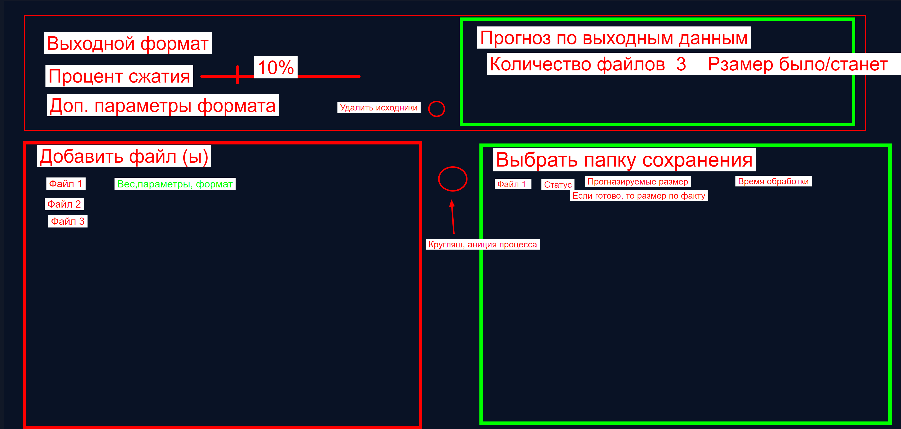

# ТЗ — конвертер видео в ЛОПАТЕ

**Статус** — принято пользователем 26.11.2026. Выпуск 0.9.26-beta. Полировка продолжится отдельно. [Исходная идея](ЛОПАТА_идея_Конвертер_видео.md)

## Цель

Добавить отдельную карточку «Конвертер видео» сразу под карточкой «Апскейл видео» в группе «Работа с видео» раздела «Обработка / утилиты». Карточка открывает окно конвертера. Основная задача — уменьшить размер готового клипа при исходном разрешении. Если сайт, редактор или другое место использования требует иного разрешения, его можно выбрать в той же утилите отдельной кнопкой. Обработка выполняется локально через FFmpeg.

## Пользовательский сценарий

1. Добавить один или несколько файлов. Для каждого показать имя, исходный размер, разрешение и длительность. Поддержать удаление отдельных файлов из очереди.
2. Выбрать выходной формат и задать процент уменьшения размера. Начальный профиль — **MP4 + AV1, исполнитель «Авто»**. Предложить отдельный профиль **«Совместимость» (MP4 + H.264)** для старых устройств и редакторов. Поддерживаемые сочетания уточнять после чтения дорожек каждого файла. Остальные режимы сжатия доступны в дополнительных параметрах.
3. Отметить галочками, что можно изменить ради меньшего файла. Если место использования предъявляет требования к кадру, выбрать выходное разрешение отдельной кнопкой «Разрешение». По умолчанию использовать разрешение исходника. При изменении разрешения сохранять пропорции и ориентацию. Показывать итоговые размеры кадра перед запуском.
4. Выбрать папку результата и запустить обработку. Показывать текущий файл, прогресс файла и очереди, кнопку отмены и понятное описание ошибки. Ошибка отдельного файла оставляет возможность завершить остальные и повторить только неудачный.
5. Показать для каждого результата исходный и итоговый размер, процент экономии, время обработки и кнопку открытия папки. Если итог крупнее, показать фактическое увеличение. Опция «Собрать готовые видео в ZIP» сохраняет рядом общий архив для передачи нескольких роликов.

## Запуск из Проводника Windows

Для поддерживаемых исходных видео в контекстном меню Проводника добавить команду **«ЛОПАТА → Перекодировать видео…»** по образцу звука и изображений. Команда открывает штатное окно конвертера и добавляет в очередь один или несколько выбранных файлов. Пользователь выбирает параметры и запускает обработку из окна. Если конвертер уже открыт, выбранные файлы пополняют его очередь с сохранением текущих настроек. Новые файлы во время обработки доступны для следующего запуска.

Использовать действующую настройку интеграции с Windows и штатную передачу запросов работающему экземпляру ЛОПАТЫ. Регистрировать собственную команду для текущего пользователя только у поддерживаемых расширений. Обновление должно доставлять команду вместе с конвертером, а отключение интеграции и удаление приложения убирать принадлежащую ЛОПАТЕ команду. Для Windows 11 проверить доступность через «Показать дополнительные параметры» по образцу аудио. [Интеграция Windows](../../Исходники/AIHub/MainWindow.WindowsIntegration.cs) · [Аудио через Проводник](2026-10-10_Перекодировка_аудио_ПКМ.md)

## Интерфейс по эскизу

[Полный макет окна конвертера](../Материалы/Конвертер_видео/Макет_конвертера.png) показывает очередь во время обработки. В нём видны настройки разрешения и сжатия, прогноз по очереди и фактический размер готового файла.

В обычном размере окна формат, разрешение и процент сжатия помещаются в одной строке. Переключатели уступок идут компактной группой. Дополнительные параметры раскрываются под основной строкой. Прокрутка нужна для длинных списков файлов.

- **Верхняя панель слева.** Выходной формат и отдельная кнопка «Разрешение» с выбранным значением, по умолчанию «Как в исходнике». Под ползунком «Уменьшить размер на» находятся видимые галочки «Что можно изменить ради меньшего файла». Здесь же находятся сворачиваемые «Дополнительные параметры» и опция «Удалить исходники после проверки». В дополнительных параметрах доступны кодек и контейнер, исполнитель, прочие режимы сжатия, частота кадров и настройки дорожек.
- **Верхняя панель справа.** Сводка по очереди показывает число файлов и общий размер «Было → Прогноз». Пересчитывать прогноз при добавлении или удалении файла и изменении настроек. При расчёте по качеству показывать оценку как приблизительную и отмечать, когда её пока нет. Когда обработка завершится, показать общий фактический размер готовых файлов и отдельно число файлов с ошибками или отменой.
- **Нижняя панель слева.** Кнопка «Добавить файлы…» и список исходников. В строке показываются имя, исходный размер, формат, разрешение и длительность. Из очереди можно убрать отдельный файл.
- **Между нижними панелями.** Кнопка «Старт» над круговым индикатором. Индикатор показывает активную обработку. Если процент доступен, показывать его вместе с текущим номером файла. На этапе с неизвестной длительностью достаточно анимации и названия этапа. По завершении или отмене индикатор останавливается.
- **Нижняя панель справа.** Выбор папки сохранения, галочка «Собрать в ZIP», отмена и список результатов. В строке результата показываются имя, статус, прогноз размера и время обработки. После проверки файла строка показывает его фактический размер и фактическое время. Для ошибки доступна причина и повтор.

## Кодеки и исполнители

| Кодек | Начальное сочетание | Назначение |
| --- | --- | --- |
| AV1 | MP4 | Основной профиль сжатия |
| H.265 / HEVC | MP4 | Альтернативный компактный профиль |
| H.264 / AVC | MP4 | Совместимость |
| VP9 | WebM | Веб-публикации |
| FFV1 | MKV | Архив и промежуточные файлы с сохранением пикселей |

Показывать только совместимые сочетания контейнера и дорожек. Для FFV1 сохранить исходные параметры изображения либо запросить решение пользователя, если исходный формат пикселей нельзя записать выбранным исполнителем. Показывать режимы сжатия, применимые к выбранному кодеку.

Дать выбор «Авто», CPU и поддерживаемых GPU. Для каждого варианта проверить доступность кодека, драйвера и требуемых параметров кадра коротким пробным кодированием. Для AV1 первыми проверить NVENC на стенде RTX 4090 и SVT-AV1 на CPU. В автоматическом режиме при недоступности аппаратного AV1 допустим запуск программного AV1 с сообщением об исполнителе. Если AV1 недоступен целиком, показать причину и предложить выбрать другой профиль. Любая смена выбранного кодека подтверждается пользователем.

В действующих сборках AV1 указан среди декодеров, а кодировщик AV1 предстоит подключить. Видеоредактор уже использует H.264 и VP9. В сборке апскейлера предусмотрены H.264, HEVC NVENC и FFV1. Перед внедрением проверить лицензии, зависимости, воспроизводимость сборки и паспорт компонента. [Видеоредактор](../../Инструменты/VideoEditorRuntime/build.sh) · [Апскейлер](../../Инструменты/VideoUpscaleRuntime/build.sh)

## Комплект поставки

Конвертер входит в основную сборку ЛОПАТЫ и готов к первому запуску сразу после установки или штатного обновления. Вместе с приложением поставляются FFmpeg и FFprobe, кодировщики и их библиотеки, поддержка заявленных входных и выходных форматов, звуковых дорожек и упаковки в ZIP. Кодировщики AV1 для CPU и поддерживаемых GPU входят в этот комплект. Поддержка конкретного аппаратного варианта определяется оборудованием и уже установленным драйвером.

В штатном запуске использовать проверенные файлы из поставки. Первый запуск, конвертация и упаковка результата работают офлайн без докачки компонентов. Подключить состав комплекта к основной сборке, подписанным манифестам новой установки и штатного обновления, лицензиям и локальной проверке комплектности.

## Режимы сжатия

- **По проценту уменьшения.** Ползунок управляет целевым размером каждого исходника. Например, 10% означает цель **900 МБ для исходника 1000 МБ**. Внутри используется тот же расчёт и проверка, что в режиме «По размеру». Число на ползунке задаёт цель, прогноз и достигнутый размер отображаются отдельно. Начальное значение ползунка выбрать на стенде.
- **По качеству.** Шкала от «Компактный файл» до «Высокое качество». Уровни привязаны к проверенным настройкам конкретного кодировщика. Начальное значение выбрать по стендовым замерам.
- **По размеру.** Пользователь задаёт верхнюю границу, например **100 МБ на каждый файл** в очереди. Объём звука, длительность и накладные расходы контейнера учитывать при расчёте видеобитрейта. После записи проверить размер в байтах. При превышении допустим повтор с пересчитанным битрейтом. Если уложиться в лимит с выбранными дорожками и настройками невозможно, показать причину и дать изменить лимит или настройки. Сохранение файла сверх лимита требует отдельного подтверждения.
- **По битрейту.** Пользователь задаёт битрейт видео. Итоговый объём зависит также от аудиодорожек, длительности и контейнера.

### Как ползунок подбирает сжатие

Ползунок задаёт цель, а ЛОПАТА может сочетать несколько способов для её достижения. Для каждого файла отдельно рассчитать доступный объём видео с учётом аудио и контейнера. Подобрать параметры выбранного видеокодировщика и при необходимости использовать повторный проход с уточнённым битрейтом.

Для каждого вида уступки предусмотрена отдельная галочка с коротким пояснением.

- **«Можно немного снизить качество картинки»** — мелкие детали могут стать менее чёткими.
- **«Можно снизить качество звука»** — звук может потерять часть деталей.
- **«Можно сделать движение менее плавным»** — движения могут выглядеть менее плавно из-за меньшего числа кадров.

Галочки по умолчанию сняты. При снятой галочке соответствующее свойство сохраняется. Для картинки без дополнительных потерь использовать перенос совместимых данных или кодирование без потерь выбранным кодеком, если такой вариант подходит. Для совместимого звука использовать копирование дорожек. ЛОПАТА может сочетать разрешённые уступки. До запуска показать, что изменится в каждом файле. При недостижимой цели показать причину и доступные варианты. Смена кодека требует явного выбора.

Выходное разрешение определяется только отдельной кнопкой. Для расчёта выхода оно используется как заданный параметр. При его изменении пересчитываются размеры кадра и прогноз результата. Целевой размер файла рассчитывается из исходного объёма и процента на ползунке.

## Архив для передачи

Галочка «Собрать готовые видео в ZIP» по умолчанию снята. При включении после обработки упаковать проверенные готовые ролики одним архивом в выбранной папке. При частичном успехе показать, какие файлы удалось добавить. Если готовых роликов нет, достаточно статуса очереди.

В режиме «По проценту уменьшения» то же значение ползунка задаёт степень сжатия ZIP. Фактический размер ZIP зависит от того, насколько уже сжаты видеофайлы. В остальных режимах использовать обычную степень сжатия ZIP. После проверки показать фактический вес архива отдельно от суммарного веса роликов.

При проверке архива сверить содержимое с готовыми файлами. Архив открывается как отдельный результат. Готовые ролики доступны и отдельно. При ошибке или отмене упаковки сохранить готовые видео и показать состояние архива.

## Сохранение видео, звука и метаданных

- Сохранять длительность, синхронизацию, пропорции, ориентацию, частоту кадров и цветовые параметры в пределах совместимости выбранного профиля. Для HDR и видео с поворотом проверять как метаданные, так и фактическое воспроизведение. Изменение цветового диапазона, глубины цвета или HDR должно быть видно пользователю до запуска.
- Подбирать совместимый профиль для каждого файла. Сначала проверить выбранный формат и предпочтительного исполнителя. При несовместимости пробовать другого исполнителя, затем совместимый контейнер с тем же кодеком и ближайшие доступные кодеки. Сохранять заданный размер кадра, параметры цвета и разрешения на изменение картинки, звука, кадров и дорожек. Для выбранного ограничения кадров сохранять исходную частоту, если она ниже. Обложки JPEG и PNG переносить в MP4.
- Показывать в результатах фактические параметры и замену профиля. В режиме по проценту сохранять проверенный файл, если он меньше исходника. Если цель не достигнута, показать фактический процент. Для заданного лимита в мегабайтах сохранение большего файла требует отдельного подтверждения.
- По возможности переносить все аудиодорожки копированием. Если для выбранного контейнера потребуется перекодирование, до запуска указать дорожку и новый формат. Если дорожку или субтитры нельзя сохранить, показать их в списке и дать сменить контейнер либо подтвердить исключение. Поддержать ролики без звука.
- Сохранять читаемую ЛОПАТОЙ историю генерации, включая сведения о моделях и время генерации. Записывать факт перекодирования отдельной записью. Для контейнера, который не поддерживает запись этих сведений, предложить совместимый формат либо явно сохранить сведения отдельным файлом по выбору пользователя. Проверять результат штатным чтением метаданных. [Чтение сведений о видео](../../Исходники/AIHub/Services/VideoEditor/VideoImportProvenance.cs)

## Интеграция и хранение

- Использовать общую подготовку FFmpeg, чтение параметров, проверку совместимости и формирование настроек кодирования. Подключить проверку к `ComponentAudit`. Спроектировать параметры и результат операции для повторного использования в апскейлере, видеоредакторе и экспорте генерации. В первом этапе сохранить действующее поведение их экспорта. Вход из «Коллекции» и карточек готовых результатов рассматривается отдельным этапом. [Runtime видеоредактора](../../Исходники/AIHub/Services/VideoEditor/VideoRuntime.cs) · [Runtime апскейла](../../Исходники/AIHub/Services/VideoUpscale/UpscaleFfmpeg.cs)
- Использовать штатный учёт фоновых операций, отмену и журнал. Отчёт по каждому файлу содержит кодек, фактический исполнитель, выбранные параметры, итог проверки и причину сбоя при наличии. При повторе сохраняются уже завершённые результаты очереди.
- Исходники читать по существующим путям. Конфликт имён разрешать новым именем либо явным выбором пользователя. Результат оформлять отдельным файлом. По умолчанию исходники сохраняются. Временные данные направлять в настроенное рабочее хранилище. На диске результата допускается короткоживущий промежуточный файл для безопасной записи после проверки. Учитывать свободное место и действующие лимиты. При отмене или сбое удалять только промежуточные файлы этой операции. [Правила хранения](2026-11-25_Хранилища_проектов_кэшей_и_обновлений.md)
- Добавить утилиту в общий каталог ЛОПАТЫ сразу после «Апскейл видео» на том же уровне группы «Работа с видео», с названием, описанием и тегами на русском и английском. Отразить кодеки, режимы и обязательные поля в каталоге агента. Перед выпуском проверить обнаружение новой механики в обновлённой сборке и подготовку задания с этими настройками. [Каталог сценариев](../../Исходники/AIHub/Services/ScenarioNavigationCatalog.cs)

## Опциональное удаление исходников

Опция по умолчанию выключена. После обработки при включённой опции ЛОПАТА показывает отдельное подтверждение со списком исходников и путями к соответствующим готовым роликам. В список попадают только исходники с проверенным, доступным итоговым файлом по отдельному пути. До подтверждения исходники доступны на своих местах.

После подтверждения отправить подходящие исходники в корзину Windows. Для ошибки, отмены, пропавшего результата, изменившегося исходника и недоступной корзины сохранить исходник и показать причину в журнале.

## Восстановление и последние настройки

- Запоминать последние параметры формата, режима сжатия, разрешения, исполнителя, дорожек, ZIP и папки сохранения. Черновик очереди сохранять после добавления или удаления файлов. Разрешение на удаление исходников заново спрашивать после проверки результатов.
- При паузе, закрытии приложения или сбое восстанавливать очередь через общий контроллер. При продолжении использовать параметры прерванного запуска. Завершённый и проверенный файл не обрабатывать повторно.
- Запоминать контрольную сумму и имя результата перед его записью. Если сбой пришёлся между записью готового файла и обновлением журнала, при восстановлении сверить контрольную сумму и принять уже записанный результат. Незаконченный файл перекодировать заново. Проверенные ролики доступны при сбое упаковки ZIP.
- Включённые голосовые уведомления сообщают о начале и завершении очереди. ЛОПАТА использует готовые записи на русском и английском. При отмене применяется обычное уведомление об отмене.

## Стенд и приёмка

Сначала снять базовые замеры, затем проверить общий компонент и утилиту. Взять готовые ролики ЛОПАТЫ в 1080p и 4K, включая 9:16. В наборе должны быть быстрые движения, зум, мелкие детали, тихие участки звука и видимая артикуляция. Для сравнения AV1, HEVC и H.264 использовать одни и те же фрагменты. Сравнить при близком размере и при сопоставимом видимом качестве. Зафиксировать оборудование, кодировщик, параметры, размер, время, заметные потери, воспроизведение и чтение метаданных. По результатам выбрать начальный уровень качества.

| Проверка | Критерий приёмки |
| --- | --- |
| AV1 на GPU и CPU | Отдельные успешные прогоны. Пользователь видит, какой исполнитель выбран и какой использован. При недоступности GPU проверен программный AV1 и явный выбор другого кодека. |
| Остальные кодеки | По одному проверенному результату H.265, H.264, VP9 и FFV1 в поддерживаемом контейнере. Для FFV1 сверены декодированные кадры. |
| Лимит файла | Размер проверенного файла укладывается в заданный предел. Проверены повтор после превышения, заведомо недостижимый лимит и применение одного предела к каждому файлу в пакете разной длительности. |
| Интерфейс и прогноз | Ползунок пересчитывает цель по каждому исходнику и итоги очереди. Сводка реагирует на состав очереди и настройки. После записи в строке видны фактический размер и время. Индикатор различает ожидание, обработку и завершение. |
| Разрешение и прогноз | Кнопка доступна при свёрнутых дополнительных параметрах. Изменение разрешения пересчитывает размеры кадра и прогноз. Процент сжатия и разрешение задаются независимо. До запуска отображаются размеры каждого результата, включая вертикальные ролики. |
| Галочки сжатия | Проверены сохранение свойств при снятых галочках, каждая уступка отдельно и сочетание нескольких. План виден до запуска, параметры сверены после записи. При недостижимой цели показано, какие настройки можно изменить. Во всех прогонах сохраняется заданное разрешение. |
| Архив для передачи | Проверены создание одного ZIP из готовых результатов, использование положения ползунка для выбора степени упаковки, отдельный показ размера ZIP, частичный успех очереди и отмена упаковки. Файлы из ZIP совпадают с готовыми роликами. |
| Формат и дорожки | Проверены вертикальные видео, 1080p и 4K, исходная и изменённая частота кадров, ориентация, цвет, несколько дорожек и ролик без звука. В совместимом контейнере проверено копирование звука. |
| Сохранность | С настройками по умолчанию исходники совпадают с оригиналом по SHA-256 после успеха, отмены и ошибки. Проверены одинаковые имена во входных папках, нехватка места и вывод на другом диске. В итоговой папке учитываются только завершённые файлы. |
| Удаление исходников | Проверены настройка по умолчанию, отказ в подтверждении, перенос в корзину после успеха и сохранение исходников при частичной ошибке, изменении файла и недоступной корзине. |
| Происхождение | Результат открывается в ЛОПАТЕ со сведениями об исходной генерации и перекодировании. Несовместимости показаны до запуска. |
| Пакет и повтор | Из нескольких файлов один отменён, один завершён с ошибкой, остальные сохранены. Повтор использует только незавершённые записи, журнал показывает результат каждого файла. |
| Восстановление и настройки | Последние настройки доступны после закрытия окна и приложения. Сбой в обработке и сбой после записи результата оставляют очередь пригодной для продолжения. Записанные файлы не дублируются. |
| Запуск из Проводника | Команда доступна по правому клику для поддерживаемых видео. Один файл и множественный выбор с пробелами и кириллицей попадают в одно окно. Проверены холодный запуск, пополнение открытой очереди, запуск только по кнопке, доступ в Windows 11 и снятие регистрации штатным переключателем. |
| Место в меню | В «Обработка / утилиты → Работа с видео» карточка «Конвертер видео» видна сразу под «Апскейл видео». Нажатие открывает окно конвертера. |
| Совместимость ЛОПАТЫ | Проходят штатные проверки экспорта апскейлера и видеоредактора. Агент видит утилиту и её настройки. |
| Поставка и первый запуск офлайн | Сверить, что обязательные файлы входят в основную сборку и доставляются при новой установке и обновлении. На чистом стенде без прежнего кэша, стороннего FFmpeg и доступа к сети сразу после установки проверить первое перекодирование в MP4 с AV1 на CPU, перенос звука и создание ZIP. Аппаратный путь проверить отдельно на поддерживаемом ПК с драйвером. |
