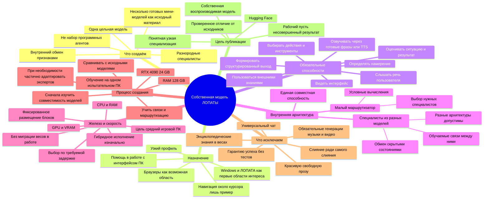

# ЛОПАТА — карта идеи собственной гибридной нейромодели

**Дата фиксации:** 23 ноября 2026 года  
**Статус:** исследовательская концепция, **не ТЗ и не поручение Codex**.  
**Предмет:** одна цельная узкоспециализированная модель, создаваемая на основе нескольких уже обученных небольших моделей разных назначений.

> **Суть:** собрать не «маленький ChatGPT» и не цепочку отдельных программных агентов, а **одну обучаемую нейросетевую систему**: разнородные специалисты взаимодействуют через внутренние представления, общий маршрутизатор выбирает необходимую работу, а блоки заранее закреплены за CPU/RAM или GPU/VRAM. Результат — быстрый, экономный и предсказуемый локальный специалист по взаимодействию с интерфейсом ПК.

## 1. Карта идеи

## 2. Согласованные опорные тезисы

| Вопрос | Текущая позиция |
|---|---|
| **Что получаем?** | **Одну более крупную модель из нескольких маленьких**, а не программную цепочку самостоятельных моделей. |
| **Что значит «одна»?** | Специалисты могут обмениваться скрытыми состояниями, признаками и внутренними представлениями; они должны обучаться совместному решению задач, а не только «знать о существовании соседа». |
| **Подход к архитектуре** | Гетерогенная модульная / MoE-подобная архитектура. **Название и конкретный метод пока не выбраны.** |
| **Специалисты** | Исходные модели могут иметь разные специализации и разные внутренние архитектуры. Не требуется сводить всё к однотипным экспертам обычной языковой MoE. |
| **Маршрутизатор** | Небольшой классификатор намерений или модель выбора вариантов — предварительный кандидат на ядро маршрутизации. |
| **Цель инференса** | **Средний современный игровой ПК.** Рабочий ориентир, не утверждённый минимум: порядка 8–16 ГБ VRAM, 32 ГБ RAM, современный CPU. Само число параметров заранее **не ограничено**. |
| **Создание и обучение** | **Только на испытательном ПК владельца проекта**: Core i9-13900KF, RTX 4090 24 ГБ, 128 ГБ RAM. Требования к выходной модели **не ограничивают ресурсы этапа создания**. |
| **Размещение при работе** | Изначально только гибрид CPU/RAM + GPU/VRAM, с **постоянно закреплёнными** специалистами. Веса между устройствами во время работы не мигрируют. |
| **Куда поместить специалиста?** | Решать **по требованиям к скорости реакции и зависимостям вычислений**, а не только по размеру модели. Медленный допустимый этап может оставаться на CPU; чувствительный к задержке — на GPU, если это выгодно. |
| **Что важнее?** | Правильность выбора, предсказуемость, скорость и экономичность важнее красоты ответа. |
| **Результат** | Пусть несовершенная, но действительно работающая, относительно самостоятельная и воспроизводимая модель с полезной специализацией — не демонстрация слияния ради слияния. |

## 3. Карта способностей (не отдельные обязательные модели)

### Вход и восприятие

- **Зрение:** распознавание экранной сцены и элементов интерфейса, их положения, изменений и локально важных деталей.
- **Слух:** понимание голосовых команд пользователя; не обязательно универсальная аудиоаналитика.
- **Намерение:** определить желаемую пользователем операцию, а не только распознать произнесённые слова.
- **Контекст:** учитывать цель, текущую ситуацию и результаты собственных предшествующих действий.

### Решение и выход

- **Выбор действия / инструмента:** формировать доступное действие, аргументы или структурированный сигнал, а не обязательно полноценный человеческий текст.
- **Проверка:** определять соответствие выбранного действия цели и замечать очевидное расхождение между ожидаемым и полученным результатом.
- **Генерация:** генерировать **специализированные выходы** (например, идентификаторы действий, координаты, оценки, управляющие сигналы), но **не обязана сочинять свободный текст**.
- **Голосовой и текстовый ответ:** может составляться **программно из готовых реплик или шаблонов**, с озвучиванием обычным TTS. Наличие человеческой речи на выходе **не требует отдельной генеративной чат-части внутри модели**.
- **Инструменты и база знаний:** модель должна уметь обращаться к предоставленным средствам. Знания о ЛОПАТЕ, Windows и браузерах предпочтительно хранить во внешнем **RAG/«Желе»**, а не жёстко зашивать в веса; окончательное решение не принято.

**Уточнение:** эти названия описывают **способности общей системы**, а не обязательно по одной отдельной исходной нейросети на каждый пункт.

## 4. Пример применения, а не окончательное назначение

**Голосовой навигатор по интерфейсу с наблюдением за курсором** (отдельно сохранён в файле `LOPATA_Идея_голосового_навигатора_по_курсору_2026-11-23.md`):

1. Пользователь **голосом** сообщает, что хочет сделать в Windows, браузере или ЛОПАТЕ.
2. Модель получает **общий обзор** экрана/окна и определяет, где находится цель.
3. Далее подробно наблюдает **за областью вокруг курсора**, а не постоянно анализирует весь экран с одинаковой детализацией.
4. Подсказывает готовыми речевыми формулами («правее», «не эта кнопка», «можно нажать») или сигналами; при необходимости сверяется с базой знаний.
5. Предупреждение перед ошибочным нажатием — пример возможного полезного поведения. Самостоятельное отведение мыши **не принято как требование**.

**Почему это лишь пример:** концепция единой модели шире этого сценария; не стоит выбирать архитектуру, исходные модели и обучение только по одному примеру работы с курсором.

## 5. Что намеренно НЕ создаём

- Универсальную разговорную LLM или уменьшенную копию ChatGPT.
- Полноценного автономного агента, которому обязательно нужен доступ ко всем действиям Windows.
- Программную связку отдельных LLM/агентов, выдаваемую за одну нейросеть.
- «Нейросеть из всего подряд» без измеримой полезной задачи.
- Собственный базовый генератор картинок, музыки и видео ради полноты возможностей.
- Обязательное обучение всей системы с нуля; предпочтение — использовать существующие предобученные компоненты там, где это обосновано.
- Динамическую перестановку весов CPU↔GPU во время инференса.

## 6. Исследовательская развилка: что именно предстоит выяснить

**Техническая реализуемость подтверждена только на уровне аналогов отдельных частей.** Общая конструкция пока **не реализована и не испытана**.

- **Совместимость разнородных специалистов:** какие внутренние представления доступны и на каких слоях их можно согласовать.
- **Способ объединения:** проекции, общее латентное пространство, cross-attention / иные обучаемые связи. Обычное усреднение весов несовместимых архитектур не подходит.
- **Глубина связи:** достаточно ли обучить маршрутизатор и новые связующие слои при замороженных специалистах или потребуется частичное совместное дообучение.
- **Маршрутизация:** какие входы вызывают каких специалистов; есть ли измеримая экономия условных вычислений.
- **Гибридное исполнение:** стоимость передачи **промежуточных данных**, задержка и реальное использование CPU/GPU при фиксированном размещении.
- **Данные:** где взять проверяемые примеры, связывающие зрение, речь, намерение, действия и их правильность. Готового обучающего датасета пока нет.
- **Сравнение:** превосходит ли объединённая модель отдельные исходные на выбранной узкой задаче по качеству/задержке/ресурсам.
- **Публикация:** проверить лицензии исходных моделей, право перераспределять итоговые веса и качество документации результата.

### Оценки ресурсов — только гипотеза

- Предварительно обсуждался прототип, которому могло бы хватить **6–16 ГБ VRAM** во время части экспериментов с замороженными экспертами. **Это не гарантированное потребление** будущего проекта.
- Обучение связей между небольшими моделями может измеряться часами или сутками; глубокое совместное дообучение — существенно дольше. **Нет расчёта до выбора архитектуры, специалистов и датасета.**
- Цель по организации домашнего эксперимента — по возможности не блокировать обычное использование ПК, но свободная VRAM не гарантирует свободных вычислительных ресурсов GPU.

## 7. Следующие вопросы, но не решения

1. Какая **одна конкретная полезная задача** станет первым проверяемым критерием успеха модели? Пример с курсором пока только кандидат.
2. Какие исходные мини-модели подходят **внутренне**, а не только по названиям возможностей и параметрам?
3. Какой минимальный набор **экспертов** нужен для самостоятельного рабочего результата?
4. Какие входные и выходные контракты между внутренними представлениями можно обучить без полного переобучения исходных весов?
5. Как измерить качество относительно базовых моделей так, чтобы было понятно, **что дала именно новая совместная архитектура**?
6. Как обеспечить приемлемую **скорость реакции на среднем игровом ПК** в фиксированной гибридной схеме?

## 8. Итог одним абзацем

**ЛОПАТА хочет создать одну компактную по требованиям к рабочему ПК узкопрофильную мультимодальную модель из нескольких разнородных предобученных специалистов.** Её маленькое ядро маршрутизирует задачи; специалисты обмениваются внутренними представлениями и учатся совместным решениям. Во время использования их веса постоянно закреплены за CPU/RAM либо GPU/VRAM в зависимости прежде всего от требуемой скорости реакции. Модель видит, слышит, понимает намерения, выбирает действия и взаимодействует с инструментами и внешними знаниями, но **не обязана свободно разговаривать или сочинять тексты**: готовые фразы и TTS обеспечивают понятную обратную связь. Обучаем и экспериментируем на RTX 4090 с 128 ГБ RAM; конечная модель ориентируется на средний игровой ПК. Первое применение и точная архитектура пока открыты. Цель — свой рабочий, пусть несовершенный, но содержательный результат, который можно будет обоснованно представить на Hugging Face.

---

**Правило статуса:** всё выше — фиксация текущего обсуждения. Это **не утверждённый состав моделей, не требования к реализации, не приказ скачивать веса, не ТЗ для Codex**.
