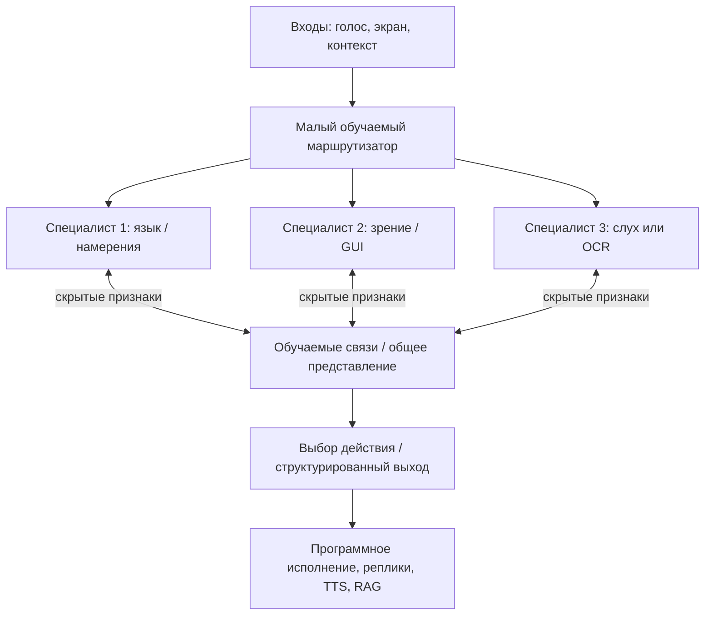
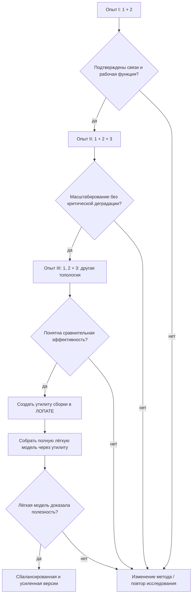

# ЛОПАТА — исследовательская идея гетерогенной нейромодели и инструмента её создания

**Дата фиксации:** 23 ноября 2026 года  
**Тип документа:** научно-исследовательская идея / программа проверки гипотез  
**Текущий статус:** гипотеза, **не реализация, не утверждённое ТЗ и не поручение Codex**  
**Перспектива:** при положительных результатах исследований — переход к самостоятельной идее реализации модели и утилиты в ЛОПАТЕ.  
**Основание:** обсуждение проекта и ранее сохранённая «Карта идеи собственной гибридной нейромодели» от 23.11.2026.

> **Короткая формулировка.** Исследовать возможность создания **одной совместно обучаемой узкоспециализированной мультимодальной нейросетевой архитектуры** из разнородных предобученных специалистов, с обменом **внутренними представлениями**, выборочной активацией и **постоянным гибридным размещением CPU/RAM + GPU/VRAM**. Начать с поэтапного объединения двух, затем трёх специалистов и сравнения топологий. **Только после успешных опытов** разработать в ЛОПАТЕ утилиту, которая воспроизводит подтверждённый метод сборки, и уже ею создать полноценную лёгкую модель; впоследствии — две более мощные конфигурации.

---

## 1. Центральная научная идея

### 1.1. Что хотим исследовать

Можно ли взять **несколько небольших нейросетей разных архитектур и специальностей**, сохранить полезные ранее выученные способности и научить их работать как **одну функциональную нейросетевую систему**, а не как программную очередь независимых моделей?

Предполагаемое отличие — в **обучаемой связи на уровне скрытых признаков**: результат обработки одного специалиста способен влиять на внутренние вычисления другого, а общие слои/связи обучаются решать одну проверяемую задачу.

Это не обычное усреднение весов несовместимых моделей, не набор отдельных агентов, не вызов модели А после завершения модели Б и не универсальная разговорная LLM. **Название будущей архитектуры и метод слияния пока не определены.** Возможны адаптеры проекций, общее латентное пространство, cross-attention, gating или иные механизмы, но ни один ещё не выбран или испытан.

### 1.2. Гипотезы

- **H1 — обучаемая интеграция:** внутренние представления гетерогенных специалистов можно согласовать так, чтобы совместная система выполняла целевую задачу, а вмешательство в межэкспертную связь измеримо меняло результат.
- **H2 — осмысленная маршрутизация:** при сохранении качества система сможет не активировать заведомо ненужные вычислительные блоки в части сценариев, снижая стоимость ответа.
- **H3 — фиксированный гибрид:** заранее закреплённые за CPU и GPU блоки смогут взаимодействовать передачей *активаций*, не передвигая веса в ходе инференса; задержка такого взаимодействия может оказаться приемлемой.
- **H4 — масштабирование:** способ, подтвердивший себя на двух и трёх специалистах, можно расширить до полного лёгкого состава без критического разрушения уже освоенных функций.
- **H5 — воспроизводимость:** подтверждённые операции удастся оформить в специальный инструмент ЛОПАТЫ так, чтобы исследователь мог повторять сборку, обучение, сравнение и экспорт интегрированной модели.

**Ни одна гипотеза не считается доказанной.** Существование похожих моделей и отдельных технологий говорит о правдоподобии исследования, но не о доказанной работоспособности предлагаемой конструкции.

## 2. Назначение и границы специализации

Исходная прикладная область — **понимание графического интерфейса компьютера и помощь в действиях с ним**: Windows, ЛОПАТА, потенциально браузеры. Голосовой навигатор, наблюдающий за курсором, — **пример**, а не окончательное техническое требование или единственный сценарий.

### Нужные способности

- **Зрение:** распознавать элементы интерфейса, подписи, координаты, состояние и изменения сцены.
- **Слух:** принимать произнесённые пользователем команды.
- **Языковое понимание:** определять смысл, цель и связи между командой и элементами интерфейса.
- **Выбор действий:** выдавать структурированные команды, координаты, оценки и другие специализированные результаты.
- **Контроль результата:** обнаруживать, когда ситуация не соответствует ожидаемой.
- **Внешние знания:** при необходимости получать актуальные сведения из RAG/«Желе» и разрешённых инструментов.

### Языковое правило — обязательное

**Все компоненты, обрабатывающие слова и смысл языка, должны хорошо работать с русским и английским, в том числе с их смешением.** Это относится к голосовым командам, распознаванию надписей на экране, определению намерения и сопоставлению команды с элементом интерфейса.

Пример проверки: «Открой *Settings*, перейди в *Privacy* и найди разрешение для микрофона» — одна непрерывная задача, а не повод потерять смысл на переключении языков. Перевод каждого запроса на английский **не должен быть обязательной архитектурной опорой**.

### Что намеренно исключается

- Универсальный чат и свободное сочинение длинных ответов.
- «Красота» речи как самостоятельная цель.
- Неограниченные знания обо всём мире, генерация художественного контента и ненужные навыки.
- Обязательная нейросетевая генерация текста для пользовательского ответа: можно **программно комбинировать готовые реплики/шаблоны**, а речь воспроизводить TTS или заранее записанными фразами.

**Важное различие:** отказ от *чат-генерации* **не означает** отказ от нейросетевой генерации **специализированных выходов** — решений, координат, параметров действия и управляющих сигналов.

**Образный ориентир:** Хаккон из истории о перерождении в торговый автомат — персонаж понимает больше, чем способен сказать. Наша модель тоже может иметь богатое восприятие и принятие решений при скромном, строго ограниченном языке ответов. **Приоритеты: предсказуемость, скорость, точность; выразительность — по остаточному принципу.**

## 3. Схема исследуемой архитектуры

Схема отражает **предмет исследования**, а не подтверждённую реализацию. Её нельзя трактовать как требование непременно запускать всех экспертов на каждом шаге или использовать одинаковую глубину взаимодействия для всех пар.

### Критерий «одной модели»

В исследовательском смысле — **единая совместно оптимизируемая вычислительная архитектура** с обучаемыми внутренними связями, согласованной функцией потерь и воспроизводимым набором параметров/конфигурации. Разные предобученные блоки могут сохранить собственные веса и архитектуры; **физически один файл с весами не является обязательным признаком успеха**.

**Недостаточно:** объединить самостоятельные программы или передавать между моделями только готовый текст/JSON и назвать это «слиянием». Нужен экспериментально подтверждённый обмен внутренними представлениями, влияющий на совместное решение.

### Гибридность по умолчанию

- Размещать блоки **постоянно**: одни на CPU/RAM, другие на GPU/VRAM.
- Веса **не мигрируют** между устройствами во время работы; передаются только необходимые данные/активации.
- Размещение выбирать по требуемой **задержке реакции и зависимостям**, а не только по размеру эксперта.
- Измерять стоимость связи между устройствами; гибридность — гипотеза об эффективности, а не заранее доказанное ускорение.

## 4. Предварительный круг исходных специалистов

**Это исследовательский резерв, а не утверждённый состав или порядок подключения.** Размеры, лицензии и пригодность соединения должны быть перепроверены перед загрузкой и использованием весов.

| Функциональная роль | Возможный кандидат | Что требуется проверить |
|---|---|---|
| Русско-английское языковое понимание | [Multilingual MiniLM-L12-v2](https://huggingface.co/sentence-transformers/paraphrase-multilingual-MiniLM-L12-v2) | Смешанные команды RU/EN, обучаемый выход признаков, лицензия Apache-2.0 |
| Компактный слух | [Whisper Base](https://huggingface.co/openai/whisper-base) | Русская/английская речь, смешанные команды, скорость CPU, доступ к признакам; Apache-2.0 |
| Альтернативный слух | [Qwen3-ASR-0.6B](https://huggingface.co/Qwen/Qwen3-ASR-0.6B) | Качество на коротких командах, стоимость инференса, интеграция внутренних признаков; Apache-2.0 |
| Русско-английский OCR | [PP-OCRv5 — мультиязычное семейство](https://www.paddleocr.ai/main/en/version3.x/algorithm/PP-OCRv5/PP-OCRv5_multi_languages.html), особенно East Slavic | Доступность конкретных весов, RU/EN OCR на скриншотах и исходные представления |
| Обнаружение элементов GUI | [OmniParser v2](https://huggingface.co/microsoft/OmniParser-v2.0), прежде всего детектор `icon_detect_v3` | Выделение нужного блока из комплекта, исходные признаки, условия лицензирования каждого компонента |
| Усиление зрительной части — резерв | [PaddleOCR-VL](https://huggingface.co/PaddlePaddle/PaddleOCR-VL), [Qwen3-VL-2B-Instruct](https://huggingface.co/Qwen/Qwen3-VL-2B-Instruct) | Есть ли реальный выигрыш для GUI, цена языковой части и интерфейс скрытых состояний |

**Предупреждение:** наличие RU/EN в описании *не является доказательством качества* смешанной речи, OCR мелкого интерфейсного текста или правильного связывания надписей с действиями. Это самостоятельный предмет испытаний.

## 5. Программа экспериментов: от двух специалистов до конструктора

### Этап I — «1 + 2»

Выбрать **два специалиста с дополняющими способностями** и конкретную задачу, в которой информация обоих действительно нужна. Обучить промежуточные связи при преимущественно замороженных основных весах, если это технически возможно. Проверить не только получение ответа, но и факт полезного взаимодействия *внутренних* признаков.

**Минимальный смысл результата:** воспроизводимая задача, где оба специалиста имеют измеримый вклад и обучаемая связь не декоративна.

### Этап II — «1 + 2 + 3»

Добавить третьего специалиста к проверенной конструкции, **сохраняя контрольную точку** из первого этапа. Проверить, сохранилась ли функция пары, добавилась ли новая полезная способность, не возникли ли чрезмерные задержки и деградация.

### Этап III — «1, 2 + 3»

Проверить **альтернативную топологию** для тех же трёх специалистов: например, первая модель взаимодействует с более тесно связанной парой **(2 + 3)**, в отличие от более общей схемы **1 + 2 + 3**. **Трактовка записи предварительная:** прежде чем писать код опыта, конкретные направленные связи нужно обозначить однозначно.

**Научный смысл:** установить, изменяются ли качество и вычислительная стоимость именно из-за **структуры взаимодействий**, а не из-за подмены моделей или данных.

### Этап IV — утилита в ЛОПАТЕ **до** полной лёгкой версии

Если первые три опыта успешны, создать **внутри ЛОПАТЫ** специальную утилиту (рабочее название: «Конструктор нейромоделей»). Она должна автоматизировать **только подтверждённые экспериментами операции**, а не обещать универсальное объединение любых моделей.

Первоначально предполагаемые возможности:

1. Выбирать и подключать поддерживаемых специалистов с описанием их входов, выходов и внутренних точек связи.
2. Задавать проверенную топологию нейросетевых связей и механизм согласования представлений.
3. Задавать заморозку/частичную настройку весов и фиксированное CPU/GPU-размещение.
4. Запускать совместное обучение, оценку качества, сравнительные испытания и сохранять контрольные точки.
5. Собирать **воспроизводимую единую модель как вычислительный граф с весами, адаптерами и манифестом**, не выдавая программный оркестратор за нейронное слияние.

Перечень — **направление продукта**, не утверждённый функциональный объём первой версии. Выбор UI, технологии реализации и форматы экспорта определяются после экспериментов.

### Этап V — полная лёгкая конфигурация

Собрать посредством новой утилиты полный **лёгкий** набор необходимых специалистов, с RU/EN, зрением, слухом и выбором действий. Выполнить end-to-end испытания на задаче управления интерфейсом и сравнить результаты с исходными специалистами и программной альтернативой.

### Этап VI — две более мощные конфигурации

При успехе лёгкой версии **тем же подтверждённым методом и утилитой** исследовать **сбалансированную** и **усиленную** модели. Их различия определит эксперимент, а не заранее установленное число параметров.

**Переходы между этапами условные.** Отрицательный результат — повод изучить причины и пересмотреть гипотезу, а не создавать полную модель или конструктор по инерции.

## 6. Как проверять научную состоятельность, а не только запуск

Для каждого опыта нужны **одни и те же тестовые задачи и сопоставимые условия** для всех сравниваемых вариантов. Датасет, точные метрики и пороги успеха пока не согласованы.

| Вопрос | Возможная проверка |
|---|---|
| Действительно ли специалисты интегрированы? | Сравнить полную конструкцию с отключённой или случайно инициализированной связью; проверить влияние внутренних признаков |
| Что добавил новый специалист? | Отдельные испытания «до/после» добавления при одинаковых примерах |
| Даёт ли преимущества новая топология? | Сравнить `1+2+3` и `1,(2+3)` при сопоставимом числе обучаемых параметров и одинаковой выборке |
| Не хуже ли это обычной программной цепочки? | Сравнить с программной связкой тех же базовых моделей, которая обменивается лишь готовыми результатами |
| Насколько устойчиво языковое понимание? | Тесты RU, EN и RU+EN, названия меню, аббревиатуры и команды с переключением языка |
| Насколько точны действия? | Верность выбора элемента, допустимые координаты, корректность следующего действия, обнаружение ошибки |
| Реально ли помогает маршрутизация? | Доля неактивных специалистов, скорость, сохранение качества |
| Реально ли полезно CPU/GPU-размещение? | Задержка реакции, расход RAM/VRAM, CPU/GPU-загрузка, затраты на передачу активаций |
| Воспроизводима ли сборка? | Повторяемость опытов, сохранение моделей, версий данных, настроек и метрик |

Для честного научного вывода желательно проводить **контрольные выключения блоков (абляции)**, сохранять исходные контрольные модели и отделять прирост от обучения адаптеров от прироста, вызванного собственно архитектурой.

## 7. Ресурсы, ограничения и принципы оптимизации

- **Исследовательский ПК:** Intel Core i9-13900KF, NVIDIA RTX 4090 24 ГБ VRAM, **128 ГБ RAM**.
- **Желаемая среда готовой модели:** средний современный игровой компьютер; конкретные RAM/VRAM-минимумы **не утверждены**.
- **На этом этапе не вводить искусственных лимитов** на число параметров, размер файлов и объём памяти; **не применять дополнительное сжатие или квантование просто ради экономии**.
- Сначала проверить взаимодействие и качество в исходной разумной точности (FP16/BF16 там, где это допустимо), затем измерять, а только потом решать, нужна ли оптимизация.
- **Скорость реакции остаётся обязательной целью** несмотря на отсутствие жёсткого лимита размера.
- Гибридный режим задаётся принципом фиксированных CPU/GPU-ролей, а не динамической выгрузкой весов.
- Научное сравнение затрат включает и время вычислений, и затраты передачи скрытых состояний, а не только размер скачиваемых весов.

## 8. Условия перехода из научной идеи в идею реализации

Идея **не становится проектом реализации автоматически** после первой успешной демонстрации. Предлагаемые контрольные условия:

1. Есть воспроизводимый эксперимент **1+2**, который показывает полезность обучаемого обмена внутренними представлениями.
2. **1+2+3** работает и приносит проверяемую новую способность без неприемлемой деградации пары.
3. Разные топологии для тройки **сравнены**; известны преимущества, слабости и вычислительная цена.
4. Результаты оценены относительно **простой программной связки** и отдельных специалистов, а также на RU/EN/RU+EN-задачах.
5. Понятны технические ограничения, лицензии и условия воспроизводимого сохранения модели.
6. Есть подтверждённый минимальный набор операций, который **имеет смысл перенести в утилиту ЛОПАТЫ**.

**Только тогда** подготовить отдельное прикладное описание реализации конструктора, затем — полной лёгкой модели, а при её успехе — двух следующих вариантов. Статус этого документа при этом остаётся историей исследования; будущее ТЗ создаётся отдельно.

## 9. Открытые научно-технические вопросы

- Какие **именно два** специалиста лучше всего выбрать для первого опыта, чтобы их совместный вклад можно было проверить?
- Какие внутренние слои доступны и подходят для передачи признаков без разрушения базовой способности?
- Нужны ли двусторонние связи на первом этапе, или достаточно одного обучаемого канала, который позднее расширяется?
- Как обучать межэкспертные связи и маршрутизатор без большого специализированного датасета?
- Как доказать, что улучшение вызвано **нейронным взаимодействием**, а не только дополнительными параметрами или обработкой текста?
- Что означают допустимые задержки в конкретных сценариях и сколько стоит передача активаций между CPU и GPU?
- Как сохранить нейронную целостность при раздельном размещении весов и при экспорте воспроизводимого результата?
- Какие исходные модели и лицензии подходят для публичного распространения в Hugging Face?

## 10. Научная новизна и ожидаемые результаты — без преждевременных заявлений

**Предполагаемый исследовательский вклад** — не само существование мультимодального помощника, а **проверенный способ глубокой обучаемой интеграции разнородных небольших моделей**, оценка топологий их взаимодействия и проверка постоянно закреплённого CPU/GPU-исполнения в узкой практической задаче.

Похожие принципы встречаются в исследованиях Mixture-of-Experts, мультимодальной фузии, адаптеров, агентных систем и гибридного инференса. **Новизна нашей конкретной комбинации не доказана**; перед научной публикацией потребуется отдельный обзор литературы и корректное сравнение с предыдущими работами.

**Возможные итоги исследования:**

- **Успех:** подтверждённая архитектура → утилита ЛОПАТЫ → лёгкая модель → сбалансированная и усиленная варианты → при наличии качества и прав на веса публикация моделей/метода на Hugging Face.
- **Частичный успех:** некоторые пары/топологии работают, другие нет; документируем границы применимости и не обещаем универсальный конструктор.
- **Отрицательный результат:** глубокая связь не даёт пользы или её вычислительная цена слишком велика; фиксируем результат и пересматриваем подход, **не подменяя его обычной агентной связкой под названием «одна модель»**.

---

## 11. Резюме в одном абзаце

ЛОПАТА исследует создание **единой узкоспециализированной мультимодальной нейромодели** из готовых разнородных специалистов. У модели должны быть развитые восприятие и понимание русских, английских и смешанных инструкций, выбор структурированных действий, но **не требуется универсальный чат**. Исследование начинается с **1+2**, затем **1+2+3**, затем сравнения с **1,(2+3)**. После подтверждения архитектуры в ЛОПАТЕ создаётся **утилита воспроизводимой сборки и обучения**, с помощью которой собирается полная лёгкая версия, а впоследствии — сбалансированная и усиленная. В инференсе специалисты постоянно закреплены за CPU/RAM или GPU/VRAM и обмениваются активациями. На старте нет искусственных ограничений на размер и квантование: первичны **работоспособность, измеримая совместность, предсказуемость, скорость и воспроизводимость**. Это **научная идея**, которая станет **идеей для реализации** только после успешных опытов.

**Связанные материалы:** «LOPATA_Карта_идеи_гибридной_модульной_модели_2026-11-23.md»; «LOPATA_Идея_голосового_навигатора_по_курсору_2026-11-23.md» (только как иллюстративный сценарий).
