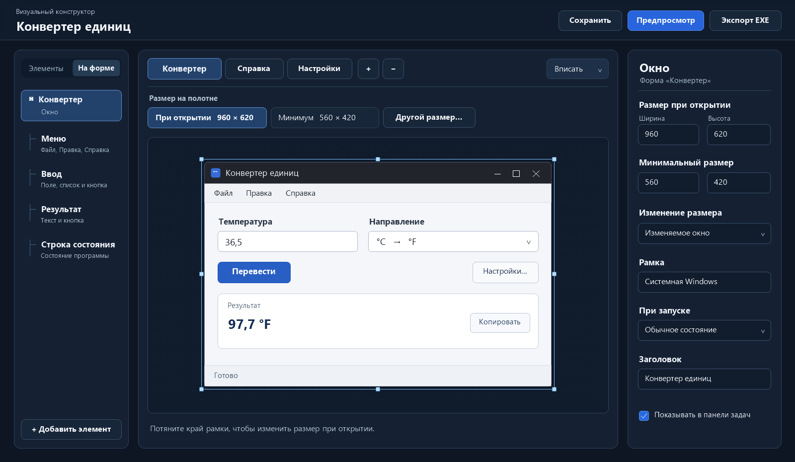

# Окна Windows и адаптивная компоновка

27.11.2026 · Требования к визуальному конструктору и программам, собранным в нём. Адаптивная компоновка входит в первый стенд. Её проверяют в экспортированном EXE при изменении размеров настоящего окна. [Рабочее ТЗ](../../Архив/2026-11-27_Визуальный_конструктор_с_Gemma.md) · [Действия, события и формы](Действия_события_и_формы.md)

## Окно готовой программы

В экспортированном EXE основное окно открывается с системной рамкой Windows. У окна есть заголовок, значок, системное меню и кнопки сворачивания, разворачивания, восстановления и закрытия согласно выбранному режиму. Размер изменяется за край или угол. Панель задач, системные команды клавиатуры и привязка к краям экрана работают по правилам Windows и выбранного режима окна. [Устройство окна WPF](https://learn.microsoft.com/en-us/dotnet/desktop/wpf/windows/) · [Режимы изменения размера](https://learn.microsoft.com/en-us/dotnet/api/system.windows.resizemode?view=windowsdesktop-10.0)

| Настройка формы | Поведение готовой программы |
| --- | --- |
| Заголовок и значок | Видны в рамке окна и в системных местах, где Windows показывает эту программу. |
| Размер при открытии | Задаёт ширину и высоту окна в обычном состоянии с учётом рамки. У разных форм могут быть свои размеры. |
| Минимум и максимум | Задают допустимый диапазон при изменении обычного размера. Верхний предел можно оставить на усмотрение Windows. В рабочей области содержимое пересчитывается под доступное место. |
| Изменение размера | «Изменяемое окно» для основного приложения, «Фиксированный размер» для компактного окна с заданными габаритами. |
| При запуске | Обычное состояние или развёрнутое окно, если выбранный режим поддерживает разворачивание. Windows восстанавливает обычное состояние с его размером. |
| Панель задач | Для главного окна включена. Для отдельного окна формы задаётся в его свойствах с учётом связи с вызывавшим окном. |

При переходе **«В этом окне»** новая форма занимает рабочую область текущего окна и перестраивается под её размеры. При открытии **«Отдельным окном»** выбранная форма получает собственный системный заголовок, стартовый размер и режим. Обе формы принадлежат созданному приложению. [Рамки окон WPF](https://learn.microsoft.com/en-us/dotnet/api/system.windows.windowstyle?view=windowsdesktop-10.0)

## Адаптивность в экспортированном EXE

- С самого начала хранить вместе с формой правила размещения элементов при изменении ширины и высоты. Экспортируемый EXE применяет эти правила при каждом изменении доступной области окна, в том числе при разворачивании, восстановлении и переходе на другую форму.
- Перетаскивание задаёт порядок и размещение. В свойствах группы доступны «Строка», «Столбец» и «Строки и столбцы». В свойствах отдельного элемента — сторона выравнивания, «По содержимому», «Заданный размер» или «Растягивать». Для строки с переносом соседние группы переходят на следующую строку, когда их минимальные размеры и отступы больше доступной ширины.
- Поле ввода и список могут растягиваться по ширине. Таблица растягивается по доступной ширине и высоте. Кнопка сохраняет размер по подписи и доступна для нажатия. Длинные пояснения переносятся. Меню остаётся сверху, строка состояния — снизу. При необходимости прокручивается рабочая область, чтобы можно было добраться до последнего поля.
- Ограничения ширины и высоты учитывают выбранные свойства элементов. Редактор показывает, какая группа перестала помещаться в проверяемый размер. Предупреждение ведёт к этому элементу и его свойствам. В экспортированном EXE содержание остаётся доступно по правилам выбранной группы, например через перенос или прокрутку.
- Размеры хранятся в логических единицах WPF. Масштаб Windows влияет на отображение, а приложение продолжает размещать элементы по доступным размерам. Предпросмотр и EXE используют одну модель размещения и один способ расчёта. [Система компоновки WPF](https://learn.microsoft.com/en-us/dotnet/desktop/wpf/advanced/layout) · [Работа с элементами в XAML Designer](https://learn.microsoft.com/en-us/visualstudio/xaml-tools/working-with-elements-in-xaml-designer)

Первый пример — конвертер. На широком окне поле температуры и список направлений стоят рядом и растягиваются. При уменьшении ширины группа направления переходит ниже. Кнопки остаются доступны, результат переносится по ширине. При добавлении места по высоте основная область получает свободное пространство. Стандартная рамка, меню и строка состояния продолжают работать.

## Настройки в редакторе

1. **Выбрать форму.** Вкладка над полотном переключает форму. Щелчок по корню «Окно» в списке слева или по рамке открывает свойства окна справа. Сохраняется быстрый переход к свойствам выбранного элемента.
2. **Задать размер.** Ввести ширину и высоту справа или перетащить край или угол рамки. При выбранном размере «При открытии» перетаскивание обновляет поля окна. «Отменить» возвращает предыдущий размер. Для минимума и максимума показывать подсказку, если введённые значения противоречат выбранному диапазону.
3. **Проверить размещение.** Над полотном доступны «При открытии», «Минимум» и «Другой размер…». В режиме проверки другой размер меняет вид на полотне и хранится как временный. Для переноса его в настройки используется явная команда «Сделать размером при открытии». «Вписать» и масштаб изменяют вид редактора. При смене режима формы и действия остаются выбраны там, где пользователь их оставил.
4. **Проверить настоящее окно.** «Предпросмотр» открывает окно, которое можно растянуть, свернуть и развернуть средствами Windows. В нём работают элементы, переходы и меню. Системные кнопки проверяются в этом окне, затем в самостоятельном EXE.

Сам редактор открывается в изменяемом окне Windows. При сужении боковые панели могут сворачиваться или переключаться вкладками, чтобы оставить место для полотна. Сохранение, предпросмотр, выбор формы и проверяемого размера остаются доступны. Выделение, масштаб и ширина боковых панелей отдельно восстанавливаются в редакторе. Большая форма помещается на полотне через «Вписать» или доступную прокрутку.

## Стандартные элементы палитры

| Область | Элементы и применение |
| --- | --- |
| Оболочка программы | Меню, контекстное меню, панель инструментов, строка состояния и вкладки внутри создаваемой программы. Их команды подключаются к каталогу действий. |
| Ввод и действие | Подпись, кнопка, текстовое поле, список выбора, список, флажок, переключатель, ползунок, индикатор хода. У элементов есть обычный фокус с клавиатуры и доступные им события. |
| Данные и содержимое | Группа, строки и столбцы, область прокрутки, таблица, дерево, изображение. Для них доступны подходящие правила заполнения окна. |
| Системные диалоги | Сообщение, подтверждение, выбор файла, сохранения и папки. Выбор принтера подключается к действиям печати из каталога. |

Используем штатные элементы платформы WPF как основу палитры. В первом стенде нужны меню, строка состояния, группы размещения, подпись, поле, кнопка, список выбора и флажок. Меню «Файл» и «Справка» выполняют реальные действия. Внешний вид вложенных элементов и системный заголовок подбираются так, чтобы были видны текст, фокус и состояния элементов при разных темах Windows. [Каталог стандартных элементов WPF](https://learn.microsoft.com/en-us/dotnet/desktop/wpf/controls/controls-by-category) · [Системные диалоги WPF](https://learn.microsoft.com/en-us/dotnet/desktop/wpf/windows/how-to-open-common-system-dialog-box)

## Примеры проверки окон

Предлагаемые размеры тестового проекта — основной конвертер 960 × 620 при открытии, минимум 560 × 420, отдельные «Настройки» 420 × 300 с фиксированным размером. Это один возможный вариант проверки. Размеры и способ проверки можно выбирать по ситуации.

| Где проверить | Что должно получиться |
| --- | --- |
| Редактор, размер при открытии | Перетащить угол и сверить поля ширины и высоты. Изменить число вручную и увидеть новую рамку. Сохранить проект и открыть снова. У каждой формы сохраняется заданный размер. |
| Редактор, проверка размеров | Переключиться на минимум и свой размер, увидеть перенос, сохранить вкладку и вернуться обратно. Проверка и масштаб оставляют выбранный размер при открытии. При слишком узком месте видна затронутая группа. |
| Узкое окно редактора | Свернуть панель, выбрать форму, открыть её свойства и вернуться на полотно. Кнопки сохранения и предпросмотра доступны при стандартном и увеличенном масштабе Windows. |
| Предпросмотр и отдельное окно | На конвертере работают системные кнопки и изменение размера. Отдельные настройки открываются со своими габаритами. Справка при внутреннем переходе занимает текущую область. |
| Самостоятельный EXE | Растянуть и сжать основное окно от широкого размера до минимума, развернуть и восстановить. Поля меняют ширину, группы переносятся, меню, кнопки и результат доступны. Введённые данные, выбор и фокус сохраняются при изменении габаритов. Пройти меню и поля с клавиатуры. |
| Самостоятельный EXE при другом масштабе Windows | На поддерживаемой Windows проверить обычный и увеличенный масштаб, длинные подписи RU/EN и доступность системных кнопок. Открыть отдельные настройки, перейти к справке в текущем окне и сравнить поведение формы с предпросмотром. |
