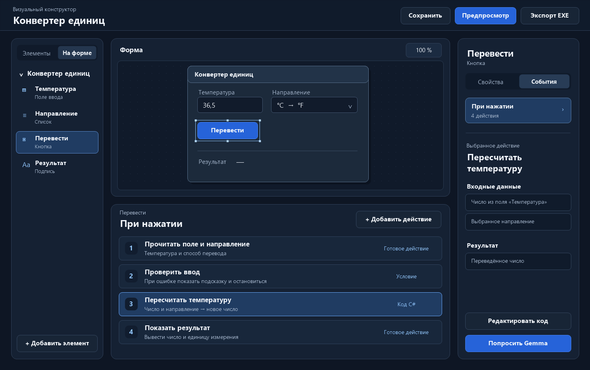
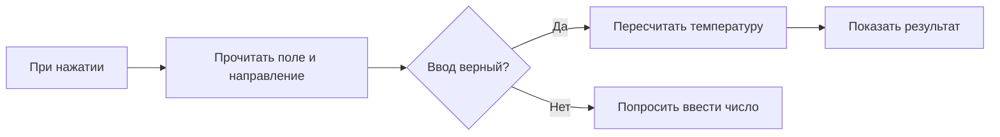

# Визуальный конструктор с Gemma — теоретическая база

27.11.2026 · Исследовательский материал к рабочему ТЗ. Наблюдения основаны на руководствах, учебных примерах и снимках интерфейса. Эскиз и сценарии проверки описывают предлагаемый первый стенд ЛОПАТЫ. [Рабочее ТЗ](../../Архив/2026-11-27_Визуальный_конструктор_с_Gemma.md) · [Исходная идея](../../Архив/ЛОПАТА_идея_визуального_конструктора_с_Gemma.md)

Для конструктора полезно соединить два приёма. AutoPlay Media Studio позволяет выбрать готовую команду, задать параметры и продолжить в том же обработчике. Visual Basic даёт короткий переход от выбранной кнопки на форме к её событию. В ЛОПАТЕ это складывается в цепочку действий с возможностью поручить Gemma один из шагов.

## AutoPlay Media Studio

### Устройство рабочего окна

В уроке 1 у AutoPlay область страницы занимает центр, линейки показывают её границы и положение, а дерево проекта и свойства находятся слева. В дереве видны страницы и диалоги. Над полотном есть их вкладки. Свойства меняются по выбранному объекту или странице и собраны в сворачиваемые категории. Руководство показывает, как менять ширину панелей, а также включать сетку для выравнивания. [Урок 1](https://www.indigorose.com/docs/ams/users_guide_lesson_1_.htm) · [Снимок с подписями](https://www.indigorose.com/docs/ams/graphics_users_guide_lesson_1_design_callouts.png)

Практический приём для ЛОПАТЫ — один и тот же выбор действует на полотне, в списке элементов и в свойствах. Сетка и контур выделения помогают размещать объекты, а размер поля можно уточнить числом. Сворачиваемые панели освобождают место, когда пользователь расставляет элементы.

### События и действия

| Что показано у Indigo Rose | Что можно применить в ЛОПАТЕ |
| --- | --- |
| У выбранной кнопки видны доступные события. Щелчок по строке события открывает сразу его вкладку редактора. После сохранения в свойствах видно, что обработчик заполнен. [Редактор событий в уроке 4](https://www.indigorose.com/docs/ams/users_guide_lesson_4_.htm) | Показать строку «При нажатии · 4 действия». Из неё открывается список действий именно этой кнопки. Счётчик помогает отличить настроенную кнопку от пустой. |
| В учебном примере кнопке выхода назначают действие через мастер. Пользователь выбирает команду в категории, заполняет её поля, а мастер вставляет вызов в текущий сценарий события. Сценарий допускает и ручное редактирование. [Урок 4](https://www.indigorose.com/docs/ams/users_guide_lesson_4_.htm) · [Снимок полей действия](https://www.indigorose.com/docs/ams/graphics_users_guide_lesson_4_action_wizard_settings.png) | «Добавить действие» открывает небольшой каталог. После выбора редактор показывает только нужные поля. Готовый шаг и обработчик на C# появляются строками одного списка и подчиняются его порядку. |
| Quick Action позволяет настроить одиночную реакцию на щелчок через простую форму. В редакторе сценариев есть отдельная вкладка на событие и справка рядом с выбранной командой. [Урок 4](https://www.indigorose.com/docs/ams/users_guide_lesson_4_.htm) · [Редактор сценариев](https://www.indigorose.com/docs/ams/program_reference_script_editor_interface.htm) · [Снимок событий кнопки](https://www.indigorose.com/docs/ams/graphics_users_guide_lesson_4_button4_properties_dialog.png) | Быстрое назначение можно сделать сокращённым входом в обычное «Добавить действие». Любую такую команду затем видно и можно передвинуть в общей последовательности. |
| В уроке с видео готовой команде воспроизведения передают конкретный объект. Руководство по переменным отдельно объясняет зависимость от порядка строк: значение появляется после того шага, который его присвоил. [Урок 7](https://www.indigorose.com/docs/ams/users_guide_lesson_7_.htm) · [Переменные](https://www.indigorose.com/docs/ams/tips_using_variables.htm) | Для параметров предлагать выбор из подходящих элементов и результатов предыдущих шагов. Если после перестановки у команды пропал источник значения, подсветить конкретное поле и предложить исправить его. |
| Предпросмотр открывает приложение для проверки вида и поведения. Публикация в папку оформлена отдельным действием с выбором назначения. [Урок 2, предпросмотр](https://www.indigorose.com/docs/ams/users_guide_lesson_2_.htm) · [Вывод в папку](https://www.indigorose.com/docs/ams/program_reference_projects_publishing_build_to_folder.htm) | На общей панели оставить «Предпросмотр» и «Экспорт EXE». В рабочем окне пользователь собирает проект, в отдельном окне проверяет его как будущий получатель программы. |

Историческая основа разбора — руководство AutoPlay Media Studio 8 и учебные страницы Indigo Rose. Справка по редактору действий и галерея производителя также показывают продолжение этого подхода в версии 9. [Руководство версии 8](https://www.indigorose.com/files/autoplay-media-studio-8-manual.pdf) · [Галерея версии 9](https://www.indigorose.com/autoplay-media-studio/screenshots/)

## Visual Basic

### Классический Visual Basic 6.0

На снимке учебного курса слева находится палитра контролов, в центре — отдельная форма с сеткой, справа — дерево проекта и таблица свойств с пояснением выбранного параметра. Небольшой Form Layout внизу показывает положение окна на экране. Эта компоновка даёт одновременный доступ к объектам, форме и параметрам. Для ЛОПАТЫ важны сама форма и понятные группы свойств. Отдельная миниатюра позиции окна пригодится, если появится задача управлять стартовым размещением окон. [Урок Paul S. Cilwa по среде VB6](https://cilwa.net/Contents/Computers/20.OnlineCourses/01.VisualBasic/01.IDE/Default) · [Снимок среды](https://cilwa.net/Contents/Computers/20.OnlineCourses/01.VisualBasic/01.IDE/ide.gif)

Пример Microsoft начинается с проекта Standard EXE. На форму добавляют кнопку, задают видимую подпись и двойным щелчком переходят к процедуре её нажатия. В примере XML Extractor настройки формы перечисляют отдельно имя элемента и его видимую подпись. Для ЛОПАТЫ отсюда следуют два решения. Двойной щелчок по кнопке в режиме редактирования открывает её основное событие. Подпись, которую видит человек, можно поменять при сохранении постоянной внутренней привязки. [Создание проекта VB6](https://learn.microsoft.com/en-us/previous-versions/windows/desktop/ms763689%28v%3Dvs.85%29) · [Пример кнопки и её события](https://learn.microsoft.com/en-us/previous-versions/office/troubleshoot/office-developer/use-office-web-components-using-aps-net) · [Форма XML Extractor](https://learn.microsoft.com/en-us/previous-versions/windows/desktop/ms762244%28v%3Dvs.85%29)

### Продолжение приёма в Visual Studio

В современном учебном примере на Visual Basic и WinForms кнопка перетаскивается из палитры на форму. Пользователь задаёт её текст и имя, добавляет подпись и связывает их через обработчик нажатия. В свойствах можно явно выбрать другое событие. Для первого стенда ЛОПАТЫ это образец короткого пути с полотна к редактору действий. У кнопки нужен также видимый вход во вкладку «События», чтобы путь работал с клавиатуры и был понятен без знакомства с двойным щелчком. [Урок Visual Basic и WinForms](https://learn.microsoft.com/en-us/visualstudio/ide/create-a-visual-basic-winform-in-visual-studio) · [Снимок палитры и формы](https://learn.microsoft.com/en-us/visualstudio/ide/media/visualstudio/toolbox-button-form.png?view=visualstudio) · [Назначение и удаление обработчика](https://learn.microsoft.com/en-us/dotnet/desktop/winforms/controls/how-to-add-an-event-handler)

В XAML Designer для WPF выделение можно менять на полотне и в дереве документа. В свойствах доступны выравнивание и порядок перекрытия. Это современный ориентир для построения редактора на стеке ЛОПАТЫ. У нас уже описаны синхронизация выделения и точная правка размеров в SVG-редакторе, а в «1С» проверены показ изменений и хранение ревизий. [Элементы в XAML Designer](https://learn.microsoft.com/en-us/visualstudio/xaml-tools/working-with-elements-in-xaml-designer) · [SVG-редактор ЛОПАТЫ](../../Архив/2026-10-23_SVG_просмотрщик_и_редактор_конструктор.md) · [Проверки «1С»](../../../Документы_проекта/Релизы/0.7.74-dev_1С_проверки.md)

## Визуал первого стенда ЛОПАТЫ

Эскиз показывает активную форму с выбранной кнопкой и открытым событием. При нескольких формах над полотном добавляются вкладки и кнопки «+» и «−». На рисунке выбран пример шага с кодом от Gemma, а обычный перевод температуры также собирается из готовых действий. [Действия, события и формы](Действия_события_и_формы.md)

| Зона | Содержание и поведение |
| --- | --- |
| Слева | «Элементы» для добавления поля, списка, кнопки или подписи. «На форме» для перехода к уже размещённым объектам. Добавить объект можно перетаскиванием или кнопкой с установкой начального положения. Выбор в списке приводит к выделению на форме. |
| В центре | Границы окна будущей программы, сетка и рамка выбранного элемента. Один щелчок выделяет, перетаскивание перемещает. Для точной расстановки доступны стрелки и числовые координаты в свойствах. Масштаб полотна влияет на отображение в редакторе. |
| Справа | Имя и тип выбранного объекта, вкладки «Свойства» и «События». У кнопки видны её текст, расположение и строка «При нажатии». У выбранного действия видно, откуда оно берёт значения и куда передаёт результат. |
| Под формой | При открытом событии показывается порядок шагов. У каждого есть короткое имя и краткие параметры. Условие раскрывается вместе с веткой. При выборе шага доступны его параметры, а у шага с кодом — «Редактировать код» и «Попросить Gemma». |
| Сверху | «Сохранить», «Предпросмотр», «Экспорт EXE». Предпросмотр открывает проверяемую форму отдельно. У редактора и проверяемой программы визуально разные роли. |

В начальном состоянии центральное полотно занимает больше места, а область действий появляется после выбора события. На узком экране боковые панели можно сворачивать, сохраняя текущий выбор и видимый путь «Перевести → При нажатии». Формат редактирования подробного обработчика обсуждается на стенде. Первую проверку удобно провести в этой компоновке и в штатном масштабе Windows 100%, 150% и 200%. Особое внимание — длинным именам, видимости кнопок, рамке выбора и работе с клавиатуры.

Способ размещения задаётся при визуальной сборке, а правила растягивания, переноса и прокрутки работают в экспортированной программе с первого стенда. У формы могут быть свои начальный и минимальный размеры. В редакторе удобно переключать проверяемый размер и изменять рамку мышью. Обновлённый эскиз показывает настройки окна с системным заголовком Windows. [Размеры и компоновка](Окна_Windows_и_компоновка.md)

## Механика проекта

### Что хранится

| Часть | Данные и связь |
| --- | --- |
| Форма | Название, свойства окна, размеры и размещённые элементы с правилами компоновки и порядком отображения. |
| Элемент | Постоянный идентификатор, тип, видимое имя, размер, положение, свойства и доступные события. Подпись можно править отдельно. |
| Событие | Привязка к форме или элементу и упорядоченный список действий. Событие «При нажатии» запускает пример ниже. |
| Действие | Команда с типами входа и результата, настроенные связи и условия. Ссылки ведут к идентификатору элемента или выхода предыдущего шага. |
| Код обработчика | Отдельный исходник, связанный с действием. Рабочая версия, черновик и результаты проверки относятся к конкретной ревизии. |

Полотно, список элементов и свойства работают с одной структурой формы в обычном проекте WPF. Предпросмотр и экспорт используют XAML, привязки событий и C# из своей папки исходников. У действия можно открыть выполняемый исходник по ПКМ. Положение панелей редактора, выделение и случайно набранные в предпросмотре данные относятся к сеансу редактирования. При удалении поля сначала показать, какие шаги на него ссылаются. Если ссылка потеряна, выделить этот шаг и объяснить, что нужно выбрать заново.

### Один щелчок по кнопке «Перевести»

| Шаг | Что вводит пользователь при настройке | Что делает программа при запуске |
| --- | --- | --- |
| 1. Прочитать поле и направление | Выбирает на форме поле «Температура» и список «Направление». | Получает число с учётом языка интерфейса, вариант °C → °F или °F → °C и признак корректного ввода. |
| 2. Проверить ввод | Выбирает условие и пишет сообщение «Введите число». | При пустом или неверном вводе показывает сообщение у поля, снимает прежний результат и завершает это нажатие. |
| 3. Пересчитать температуру | Собирает выражение для выбранного направления. В пробном варианте может поручить этот шаг Gemma. | По числу и направлению вычисляет новое число. Единицы измерения и округление для показа задаёт форма. |
| 4. Показать результат | Указывает подпись «Результат» и вид результата. | Записывает в подпись переведённое число с единицей. |

Действия выполняются сверху вниз. Каждое нажатие берёт текущие значения и создаёт свой набор результатов. Шаг может выбирать из результатов предыдущих шагов, из явно связанных полей и из заданных значений. Редактор проверяет типы и наличие источников до запуска. Например, если «Показать результат» перенесено выше расчёта, карточка показывает недоступный источник и позволяет восстановить связь. Механика штатных команд проверяется отдельно с выключенной моделью.

### Что получает Gemma и что она возвращает

При выборе «Попросить Gemma» редактор передаёт описание задачи, нужный элемент и событие, доступные действия, типы входов и результатов и версию проекта. Для предложения C# передаётся код выбранного действия. Для температурного примера достаточно числа, направления и требования вернуть число. Проверку пользовательского ввода и вывод в подпись выполняют настроенные штатные шаги. Поэтому один обработчик легко проверить на нескольких значениях.

Gemma возвращает черновик короткой цепочки для события или реализации C# выбранного действия. Редактор показывает различия, проверяет привязки и сборку. Пробный запуск можно выполнить на выбранных данных в изолированном процессе. «Применить» записывает проверенный вариант в актуальную ревизию. При конфликте с новой правкой пользователь видит обе версии и может заново запросить предложение. Сообщение об ошибке ведёт на проблемную строку. Запрос исправления включает строку, диагностику и прежнюю задачу, а результат возвращается как новый черновик. [Модель диагностики Roslyn](https://learn.microsoft.com/en-us/dotnet/csharp/roslyn-sdk/compiler-api-model)

Компиляция, пробное поведение и разрешения процесса проверяются отдельно. Для первого стенда обработчику достаточно переданных значений и временной рабочей области. В тесте нужно убедиться, что ограничения доступа действуют, а отмена и зависание оставляют редактор и сохранённую версию доступными.

### Предпросмотр и экспорт

Предпросмотр проверяет выбранную версию проекта в отдельном окне. Дизайнерские рамки, сетка и панель Gemma остаются в редакторе. При сборке применяется та же структура формы, порядок шагов и подтверждённая версия функции. Кандидат для первого экспорта — папка с EXE, ресурсами и необходимой средой .NET для целевой Windows. Состав подтверждается на итоговом комплекте. На машине без ЛОПАТЫ, Gemma и сети он должен воспроизвести результаты предпросмотра. [Способы публикации .NET-приложений](https://learn.microsoft.com/en-us/dotnet/core/deploying/)

## Примеры проверки

Ниже возможные пробы. Для приёмки можно подобрать любой способ, который показывает работу созданного проекта и собранного EXE.

| Проба | Наблюдаемый результат |
| --- | --- |
| Собрать пустую форму | Все четыре типа элементов доступны из палитры. При клике по элементу на форме и в списке выделение и свойства совпадают. |
| Найти поведение кнопки | На событие можно перейти двойным щелчком, через вкладку «События» и клавиатурой. Везде открывается тот же список действий. |
| Переставить или удалить источник значения | Подсвечивается затронутый шаг с указанием поля. Переименование подписи, сохранение и повторное открытие сохраняют целую связь. |
| Добавить действия с выключенной Gemma | Чтение, проверка, расчёт и вывод выполняются в предпросмотре без сети. Переходы между формами проверяются по каталогу. |
| Пройти цикл с Gemma | Пользователь видит предлагаемые карточки для события или код выбранного действия до применения. Принятый результат можно сохранить и откатить. |
| Проверить расчёты | 0 °C даёт 32 °F, 32 °F даёт 0 °C, −40 одинаков в обеих шкалах. 36,5 °C даёт 97,7 °F, дробь отображается по языку программы. После верного расчёта неверный ввод показывает подсказку в форме. |
| Сменить размер и масштаб | В редакторе можно проверить форму при разных размерах. В экспортированном EXE перетаскивание рамки перестраивает элементы по заданным правилам. |
| Сравнить предпросмотр и EXE | Проверить одинаковые контрольные значения, клавиатурный порядок и сообщения на чистой поддерживаемой Windows. Сбой пробного запуска или повторной сборки сохраняет рабочую версию. |

Эта компоновка пригодна для первого сквозного примера. На нём прежде всего стоит проверить, находит ли пользователь событие самостоятельно, может ли прочитать порядок действий и понимает ли, какую часть предложила Gemma. Эти наблюдения определят, какие панели, команды и типы событий добавить следующими.
